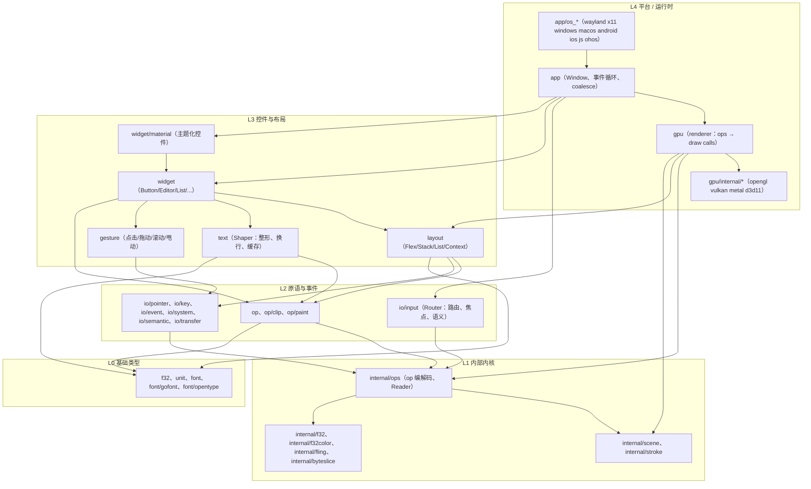
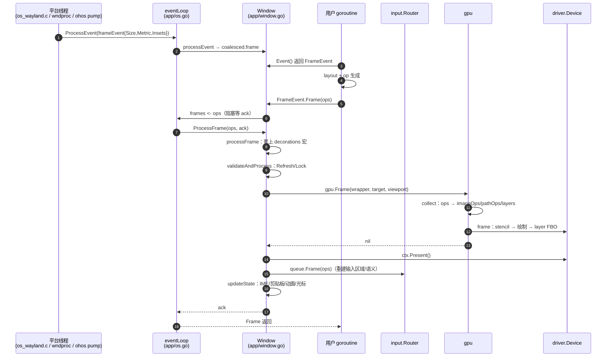
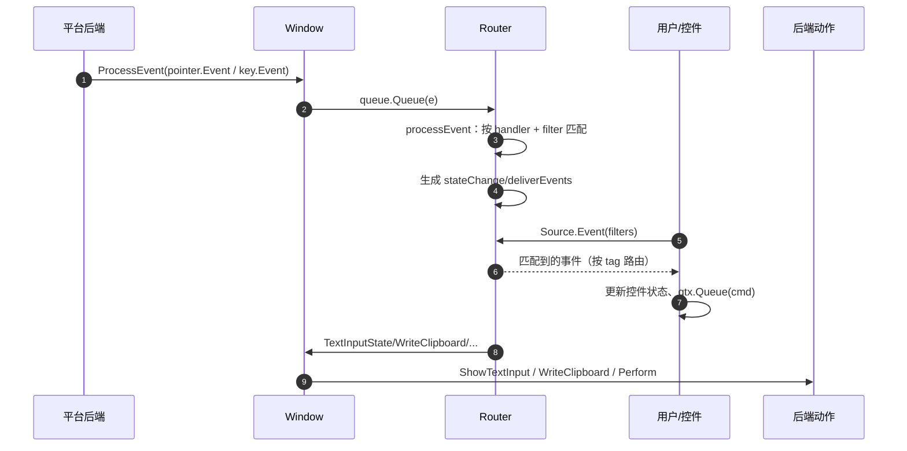

# Gio 架构总览

> 分析对象：`/Users/mahesh/AiWork/gio`（`gioui.org`），分支 `ohos`，基线 `7efc307f`。
> 本文回答三个问题：项目由哪些层与模块组成、一帧渲染与一次输入事件如何流动、模块之间的依赖规则是什么。
> 文中路径均相对仓库根目录，行号对应当前 HEAD。

---

## 1. 项目定位与规模

Gio 是一个用 Go 编写的**即时模式（immediate mode）跨平台 GUI 框架**，支持 Android、iOS、macOS、Linux/FreeBSD/OpenBSD、Windows 以及 WebAssembly；本仓库额外包含 **OpenHarmony（OHOS）** 后端与若干 macOS/桌面增强。

| 指标 | 数值 |
|---|---|
| Go 包数 | 50 |
| 非测试 Go 代码 | 51,008 行（183 个 `.go` 文件，另有 53 个测试文件） |
| 测试代码 | 12,360 行，测试/代码比 ≈ 0.24 |
| Go 版本 | `go 1.24.0`（本地需 go1.27.x 工具链，见 §10） |
| 直接依赖 | `gioui.org/shader`、`go-text/typesetting`、`eliasnaur.com/font`、`golang.org/x/{exp,image,sys,text,net}`、`godbus/dbus` |
| 相对上游 `origin/main` | +2,444 / −20 行，40 个文件（OHOS 后端、macOS 捏合、文件拖放、4/5 号鼠标键） |

核心设计取舍（决定了后文所有架构特征）：

1. **UI 被编译成一段字节码（op stream），而不是一棵保留的控件树。** 每帧重新生成，天然无状态、易并行、易跨后端。
2. **同一份 op stream 被两个消费者读取**：`gpu` 读它画图，`io/input` 读它重建命中测试区域与语义树。这是 Gio 最核心的"单一事实来源"设计。
3. **几乎没有对象分配**：op 写入复用 `[]byte`，输入/渲染的中间数组按帧 `[:0]` 复用，路径与字形有 LRU 缓存。
4. **平台后端只产生事件、消费帧**，不参与布局与绘制；GPU 后端只实现一个即时模式命令接口 `driver.Device`。

---

## 2. 分层架构



**各层职责**

| 层 | 职责 | 关键约束 |
|---|---|---|
| L0 基础 | `f32`（浮点几何/仿射）、`unit`（dp/sp→px）、`font`（字体描述与解析） | 不依赖任何上层；`internal/f32` 是 `f32` 的内部加速版 |
| L1 内部内核 | op 的二进制编码/解码、场景命令、描边、颜色空间、惯性动画 | 只被本仓库消费；`EncodedOp.Refs` 跨包泄漏（见 §6 风险） |
| L2 原语/事件 | 绘制原语（clip/paint）、输入过滤器与事件类型、Router | 只操作 op，不关心窗口与 GPU |
| L3 控件/布局 | 布局约束求解、控件状态机、文本整形、手势识别 | 通过 `layout.Context` 获取 `Op`、`Source`、`Metric` |
| L4 平台/运行时 | 窗口生命周期、事件循环、GPU 渲染与呈现 | 平台差异被 `driver` 接口与 build tag 隔离 |

---

## 3. 四个核心抽象

### 3.1 `op.Ops`：把 UI 编译成字节码

```
用户代码 ──paint.ColorOp.Add(ops)──▶ []byte + []any(refs)
                     ▲                    │
                     │                    ├─▶ gpu: 解码 → drawOps → GPU 命令
      op.Record/Stop 宏、Save/Load 状态 ───┘
                     └──────────────────────▶ io/input: 解码 → 命中区域/语义树
```

- `op.Ops` 内部是 `internal/ops.Ops`：`data []byte` + `refs []any` + `stringRefs []string`（[internal/ops/ops.go:15-41](../internal/ops/ops.go#L15-L41)）。字符串引用单独存放，避免接口装箱导致的堆分配。
- 每个 op 由 1 字节类型 + 定长/变长负载组成；`ops.Write` 返回可写的切片（[internal/ops/ops.go:189](../internal/ops/ops.go#L189)），调用方直接填字段。
- **Key 身份**：`EncodedOp.Key = {ops 指针, pc, version}`（[internal/ops/reader.go:26-31](../internal/ops/reader.go#L26-L31)）。`version` 在每次 `Ops.Reset` 时自增（[internal/ops/ops.go:186](../internal/ops/ops.go#L186)），因此 Key 天然标识"这一帧里的这个位置"。GPU 路径缓存直接把它当 key——这带来一个跨帧缓存失效问题（见风险 P2）。
- **宏与状态**：`op.Record/Stop`（[op/op.go:148](../op/op.go#L148)）把一段 op 录成 `CallOp`，可重复 `Add`；`op.Defer`（[op/op.go:124](../op/op.go#L124)）实现延迟绘制（用于窗口装饰、滚动条等）。`Save/Load` 保存/恢复变换栈。所有 push/pop 都用 StackID 校验配对，错配会 `panic("unbalanced ...")`（[internal/ops/ops.go:252-314](../internal/ops/ops.go#L252-L314)）。
- **Reader**：`ops.Reader.Decode`（[internal/ops/reader.go:78](../internal/ops/reader.go#L78)）是唯一的解码入口，内部用 `Refs` 表把类型断言成具体类型（如 `*image.RGBA`、`event.Tag`）。解码失败/类型不符没有错误返回，只有 panic。

> 设计收益：零分配、可录制回放、GPU 与输入共享同一份数据、跨后端一致。
> 设计代价：op 流不可自描述、无版本号、调试只能靠 `GIO_DEBUG` 开关和字节偏移；所有错误都是 panic（见风险 A1）。

### 3.2 `layout.Context`：一帧的"环境"

```go
type Context struct {
    Constraints Constraints   // Min/Max，整数像素
    Metric      unit.Metric   // Dp/Sp → px
    Now         time.Time     // 动画时间
    Locale      system.Locale
    Values      map[string]any
    input.Source              // 事件读取入口
    *op.Ops                   // 绘制/输入 op 写入入口
}
```

（[layout/context.go:17-37](../layout/context.go#L17-L37)）

它是**值类型**，布局函数通过复制它来派生约束；控件状态必须存放在调用方持久化的结构体里（如 `var btn widget.Button`），这是 Gio 与保留模式框架最大的使用差异。`Constraints` 只有整数像素，没有浮点布局；`Dimensions` 只带 `Size` 与 `Baseline`（[layout/layout.go:16-36](../layout/layout.go#L16-L36)）。

### 3.3 `input.Source` / `Router`：事件的路由中枢

- 窗口持有一个 `input.Router`（[app/window.go:64](../app/window.go#L64)），每帧把用户 op 交给 `Router.Frame`（[io/input/router.go:341](../io/input/router.go#L341)）。
- `Router.collect`（[io/input/router.go:787](../io/input/router.go#L787)）再次解码同一份 op：
  - `TypeClip` → 构造命中区域树（`areas`）与命中链（`hitTree`）；
  - `TypeInput` → 注册 handler（`map[event.Tag]*handler`）；
  - `TypeSemantic*` → 构造无障碍语义树；
  - `TypeKeyInputHint`/`TypeActionInput` → 键盘焦点与系统动作。
- 用户调用 `gtx.Source.Event(pointer.Filter{...})`（[io/input/router.go:211](../io/input/router.go#L211)）声明"我要什么事件"，Router 用**上一帧**声明的过滤器路由**本帧**事件（双缓冲 `filter/nextFilter`，[io/input/router.go:132-136](../io/input/router.go#L132-L136)）。因此在第一次 Layout 之前调用 `Event` 必然读不到事件——这是常见的新手陷阱。

### 3.4 `gpu.GPU` / `driver.Device`：渲染的两级接口

- `gpu.GPU`（[gpu/gpu.go:40-50](../gpu/gpu.go#L40-L50)）是给 `app` 用的窄接口：`Frame/Clear/Release/Profile`。
- `driver.Device`（[gpu/internal/driver/driver.go:17-55](../gpu/internal/driver/driver.go#L17-L55)）是给 4 个 GPU 后端用的即时模式命令接口（BeginFrame/BindPipeline/DrawArrays/...）。
- 后端通过 `init()` 注册到包级变量（[gpu/internal/driver/api.go:86-89](../gpu/internal/driver/api.go#L86-L89)），`gpu` 在共享代码里 blank-import 全部后端（[gpu/gpu.go:33-38](../gpu/gpu.go#L33-L38)）。

---

## 4. 一帧的生命周期



逐步对应代码：

1. **平台产帧**：后端把 `FrameEvent` 通过 `callbacks.ProcessEvent` 送入；`Window.processEvent` 计算 insets 后的 viewport，重置装饰 ops 并用 `op.Record` 录下装饰宏（[app/window.go:623-663](../app/window.go#L623-L663)）。
2. **交付用户**：`Event()` 从 coalesce 队列取事件（[app/window.go:747](../app/window.go#L747)）；`frameEvent.Frame` 被替换为 `w.driver.Frame`，`Source` 被替换为 `w.queue.Source()`（[app/window.go:633-634](../app/window.go#L633-L634)）。
3. **回送帧**：用户调用 `e.Frame(ops)` → `driver.Frame` → `eventLoop.Frame` 把 `*op.Ops` 发到 `frames` 通道并等待 `frameAck`（[app/os.go:260-265](../app/os.go#L260-L265)）。
4. **包装**：`processFrame` 把用户 ops 作为一个 `CallOp` 嵌进装饰宏，并叠加 `op.Offset`（[app/window.go:234-249](../app/window.go#L234-L249)）。装饰因此与用户内容共享一次 GPU 提交。
5. **提交 GPU**：`validateAndProcess`（[app/window.go:134-217](../app/window.go#L134-L217)）是一个重试状态机：
   - 无 `context` 则创建；`sync` 时 `Refresh()`；
   - `Lock()` 后在首次需要时 `gpu.New(ctx.API())`；
   - `w.frame` 做 `gpu.Clear` + `gpu.Frame`；
   - 先给客户端发 ack，再 `Present()`（避免阻塞用户 goroutine）；
   - `errOutOfDate` → 重新 `Refresh` 重试；`ErrDeviceLost` → 销毁并重建 GPU。
6. **GPU 内部**：`gpu.Frame` = `collect`（[gpu/gpu.go:384](../gpu/gpu.go#L384)）+ `frame`（[gpu/gpu.go:398](../gpu/gpu.go#L398)）：
   - `collect` 解码 op，产出扁平数组 `imageOps`（绘制项）、`pathOps`（裁剪几何）、`layers`（不透明度组）与复用的顶点缓冲 `vertCache`；
   - `frame` 依次：上传路径 → 打包 stencil 图集 → 每个 clip 做一次覆盖渲染 → 处理多 clip 交集 → 上传纹理 → 把 layer 渲染到 FBO → 最终 pass 逐个绘制。
7. **输入重建**：`queue.Frame(frame)`（[io/input/router.go:341](../io/input/router.go#L341)）重建 handler 活跃集合、命中树与语义树，然后 `updateState` 读取 `TextInputState`/`WriteClipboard`/`WakeupTime` 等命令并驱动平台（[app/window.go:251-280](../app/window.go#L251-L280)）。
8. **空闲/动画**：`updateAnimation` + `scheduleInvalidate`（[app/window.go:367](../app/window.go#L367)）用一条后台 goroutine 定时唤醒；`SetAnimating(true)` 时后端尽可能快地连续产帧。

> 关键点：**一帧只解码两次**（gpu 一次、input 一次），且都基于同一份 op 字节流；没有中间控件树，也没有 diff/patch。

---

## 5. 一次输入事件的生命周期



- 平台事件首先进入 `Window.processEvent`（[app/window.go:623](../app/window.go#L623)）：`ConfigEvent`/`ViewEvent`/`FileDropEvent` 等被合并进 `coalesced`；普通 `event.Event` 直接 `queue.Queue`。
- Tab/Shift-Tab（移动端方向键）被包装成 `input.SystemEvent`，若没有 handler 消费则触发 `moveFocus`（[app/window.go:705-740](../app/window.go#L705-L740)）。
- `Router.Event`（[io/input/router.go:218](../io/input/router.go#L218)）按过滤器匹配，并从 `changes` 中 `slices.Delete` 已消费事件；焦点事件与键盘事件有单独的 `keyQueue`。
- 指针路由的核心是 **hitTest**（[io/input/pointer.go:548-576](../io/input/pointer.go#L548-L576)），它沿 `hitTree` 从后向前遍历，每个命中节点都要沿 `area.parent` 链做逆变换与包含测试（[io/input/pointer.go:578-595](../io/input/pointer.go#L578-L595)）。
- 控件通过 `gtx.Queue(cmd)` 发起命令（移动焦点、请求剪贴板、唤醒），命令在 `Router.executeCommands` 中统一执行（[io/input/router.go:537-575](../io/input/router.go#L537-L575)）。

---

## 6. 模块清单与职责

> LOC 为非测试行数；"依赖"只列同仓库内的重要依赖。

### 6.1 对外 API 包

| 包 | LOC | 职责 | 关键类型 | 主要依赖 | 测试比 |
|---|---:|---|---|---|---|
| `app` | 15,105 | 窗口、事件循环、平台后端、IME、剪贴板、语义桥 | `Window`、`FrameEvent`、`Config`、`driver`、`eventLoop` | gpu, io/*, layout, text, widget, `widget/material` | 0.08 |
| `gpu` | 2,568 | op → GPU 命令的渲染器、stencil/clip 图集、纹理缓存 | `GPU`、`renderer`、`drawOps`、`pathOp`、`material` | driver, internal/ops, scene, stroke, layout | 0.02 |
| `layout` | 1,288 | 约束求解、Flex/Stack/List、`Context` | `Context`、`Constraints`、`Dimensions`、`Flex`、`List` | op, op/clip, io/pointer, gesture, unit | 0.63 |
| `text` | 1,980 | 文本整形（go-text）、换行/bidi、段落缓存、字形/位图缓存 | `Shaper`、`Parameters`、`Glyph`、`document` | font, op, op/paint, system | 0.70 |
| `widget` | 4,442 | 有状态控件：Button、Editor、List、Selectable、Scrollbar… | `Editor`、`textView`、`glyphIndex`、`editBuffer` | layout, text, gesture, io/* | 0.82 |
| `widget/material` | 1,853 | Material 主题化包装 | `Theme`、`ButtonStyle`、`EditorStyle`… | widget, layout, text, icons | 0.04 |
| `gesture` | 480 | 手势识别状态机 | `Click`、`Drag`、`Scroll`、`Fling` | io/pointer, internal/fling | 0.40 |
| `op` / `op/clip` / `op/paint` | 231 / 548 / 212 | 绘制原语与宏/变换栈 | `Ops`、`MacroOp`、`CallOp`、`Path`、`PaintOp` | internal/ops, scene, stroke | 0.16 / 0.38 / 0 |
| `io/input` | 2,385 | 事件路由、指针/键盘队列、焦点、语义树 | `Router`、`Source`、`handler`、`pointerQueue` | internal/ops, io/* | 0.86 |
| `io/{pointer,key,event,system,semantic,transfer,clipboard}` | 1,274 | 事件与过滤器类型、语义/系统动作 | `pointer.Event`、`key.Event`、`semantic.ClassOp` | op, internal/ops | 0–0.21 |
| `f32` / `unit` | 243 / 79 | 浮点几何、单位换算 | `Affine2D`、`Point`、`Metric` | 无 | 1.59 / 0.62 |
| `font` / `font/opentype` / `font/gofont` | 402 | 字体描述、OpenType 解析、内置 Go 字体 | `Font`、`Face`、`Collection` | go-text | 0 |

### 6.2 内部支撑包

| 包 | LOC | 职责 | 说明 |
|---|---:|---|---|
| `internal/ops` | 689 | op 二进制格式、Writer、Reader、Stack 校验 | **全项目最关键的内部契约**，被 op/io/gpu 三方共享 |
| `internal/scene` | 252 | 路径命令（Line/Quad/Cubic/Gap）的紧凑表示 | clip/stroke/gpu 共用 |
| `internal/stroke` | 763 | 多边形描边、三次贝塞尔细分 | 仅被 clip 与 gpu 使用 |
| `internal/f32`, `internal/f32color`, `internal/fling`, `internal/byteslice` | 178/218/429/23 | 浮点运算、sRGB↔linear、惯性外推、零拷贝字节视图 | 纯函数，易测但多数无测试 |
| `gpu/internal/driver` | 384 | GPU 后端命令接口与类型 | 4 个后端的公共契约 |
| `gpu/internal/{opengl,vulkan,metal,d3d11}` | 1,552/1,168/1,194/878 | 具体后端 | 0 测试；平台/驱动差异集中地 |
| `internal/{gl,vk,d3d11,egl}` | 3,177/2,281/1,695/545 | 平台图形 API 绑定（手写 FFI） | 无测试，unsafe 密集 |
| `app/internal/{windows,xkb,ibus}` | 1,019/384/334 | Win32、XKB、IBus 绑定 | 无测试 |
| `app/permission/*` | 51 | Android/iOS 权限声明 | 纯常量 |
| `gpu/headless` | 414 | 离屏渲染（测试/截图） | 测试比 0.88，是渲染回归的主要抓手 |

---

## 7. 依赖关系与规则

### 7.1 实际的包依赖（同仓库边）

```
f32 ◀── internal/f32 ◀── internal/scene ◀── internal/stroke ◀── op/clip ◀── op/paint ◀── text
 │                          ▲                                     ▲
 └── op ◀── internal/ops ◀──┴─────────────────────────────────────┘
             ▲   ▲   ▲
             │   │   └── io/input ◀── io/{pointer,key,event,system,semantic,transfer}
             │   └────── gpu
             └────────── io/*
layout ──▶ op, op/clip, gesture, io/{input,pointer,system}, unit
gesture ─▶ io/{event,input,key,pointer}, internal/fling, op
widget ──▶ layout, text, gesture, io/*, op/{clip,paint}, internal/f32color
widget/material ─▶ widget, layout, text, io/*, materialdesign/icons
text ────▶ font, font/opentype, op, op/{clip,paint}, io/system
app ─────▶ gpu, io/*, layout, text, widget, widget/material, internal/*
```

**无环**：`go list ./...` 可完整解析，不存在 import cycle。

### 7.2 依赖规则（应然）

1. 下层不得依赖上层（L1/L2 不应 import L3/L4）。
2. `app` 应只依赖"运行时契约"（`driver`、`io/*`、`op`），不应依赖具体控件库。
3. `gpu` 不应依赖布局语义（`layout`），只应依赖几何与 op。
4. 平台差异必须收敛在 `app/os_*` 与 `gpu/internal/*`，共享代码中不出现 `GOOS` 分支。
5. `internal/*` 的类型不应对公共 API 泄漏。

### 7.3 实际违规与异味

| 违规 | 证据 | 后果 |
|---|---|---|
| **L4→L3 依赖**：`app` import `widget` 与 `widget/material` | [app/window.go:29-30](../app/window.go#L29-L30)；`init()` 里 `material.NewTheme()` + `material.Decorations`（[app/window.go:761-793](../app/window.go#L761-L793)） | `app` 传递依赖 173 个包（`widget` 136），任何窗口程序都拖入整套 Material 主题、图标与字体；窗口初始化有一笔与本应用无关的整形/主题开销 |
| **L4→L3 依赖**：`gpu` import `layout` | [gpu/gpu.go:28](../gpu/gpu.go#L28)，仅为 3 处 `layout.FPt`（[gpu/gpu.go:1088](../gpu/gpu.go#L1088)、1369、1370） | 一个纯几何渲染器被绑定到布局包；应下沉为 `f32.FRect` 或本地 helper |
| **L3→L2 反向**：`text` import `op/paint` 并可向 op 写入 | [text/gotext.go:654-698](../text/gotext.go#L654-L698) | 整形器承担了绘制职责，缓存里存 `paint.ImageOp`；职责不单一 |
| 共享代码中出现 `runtime.GOOS` 分支 | [app/window.go:220-227](../app/window.go#L220-L227)（JS 透明清屏）、[app/window.go:707](../app/window.go#L707)（移动端焦点键） | 平台差异未完全收敛，新增平台需改共享文件 |
| `internal/ops` 类型直接出现在公共包逻辑中 | `io/input` 与 `gpu` 都用 `ops.EncodedOp`、`ops.Key`、`EncodedOp.Refs[0].(T)` | 内部格式变更会同时破坏两个消费者；`Refs` 的类型断言是 panic 源 |
| 全局可变注册表 | [gpu/internal/driver/api.go:86-89](../gpu/internal/driver/api.go#L86-L89) 的 `NewOpenGLDevice` 等包级变量，由 `init()` 写入 | 无法注入假后端；测试被迫编译全部后端 |
| 全项目无 `context.Context` | `app` 无取消/超时机制，资源释放靠 `DestroyEvent` 与 `Release()` | 窗口创建/关闭失败时缺少统一取消路径（见风险 A1） |

---

## 8. 并发模型

| 执行体 | 生命周期 | 拥有的状态 | 与谁通信 |
|---|---|---|---|
| **平台事件线程** | `osMain` / `runtime.LockOSThread` | 原生窗口、GPU context（GL/Metal 需同线程） | 通过 `eventLoop.events`/`frames` 通道与客户端交互 |
| **客户端 goroutine** | 用户 `main` | `Window`、`Router`、控件状态、`Shaper` | 调 `Event()`/`Frame()`/`Invalidate()` |
| **定时器 goroutine** | 首次 `scheduleInvalidate` 时创建，`DestroyEvent` 时退出 | `time.Timer` | 调 `Window.Invalidate()` |
| **`app.Run` 回调** | 每次调用 | 用户函数 | 由平台线程执行，阻塞等待完成 |
| **GPU 上下文** | 窗口生命周期 | 纹理/缓冲/管线 | 仅在 `ctx.Lock()` 期间由渲染路径使用 |

同步契约：

- `Window.Invalidate` 可在任意 goroutine 调用（`invMu` 保护，[app/window.go:325-334](../app/window.go#L325-L334)）。
- 其余 `Window` 方法、`Router`、`Shaper`、所有控件**都不是并发安全的**；`text.Shaper` 明确文档为单 goroutine（[text/shaper.go:208-216](../text/shaper.go#L208-L216)），而 `material.Theme.Shaper` 被整个窗口共享。
- `eventLoop` 的通道大多无缓冲（`events`、`frames`、`frameAck`），本质是**会合（rendezvous）语义**：客户端处理慢会直接阻塞平台事件线程，进而阻塞原生消息泵。这是吞吐上限，也是"卡顿时系统窗口无响应"的根因之一。
- `windowRendezvous`（[app/os.go:212-243](../app/os.go#L212-L243)）是死代码：类型、构造函数与后台 goroutine 均未被使用（staticcheck U1000 已确认）。

---

## 9. 平台后端矩阵

| 平台 | 文件 | 行数 | 窗口/事件源 | GPU 路径 | 备注 |
|---|---|---:|---|---|---|
| Wayland | `app/os_wayland.go` | 2,221 | `wl_display` + 自建 event loop | EGL + GLES / Vulkan | 最大、最复杂；含 CSD（客户端装饰） |
| Android | `app/os_android.go` | 1,583 | `ANativeWindow` + `ALooper` | EGL + GLES | 含前台服务、权限 |
| Windows | `app/os_windows.go` | 1,492 | `wndproc` + 消息循环 | WGL / D3D11 | 单一 `windowProc` 276 行 |
| macOS | `app/os_macos.go` | 1,246 | Cocoa `NSApplication`（`os_macos.m`） | Metal / OpenGL | 捏合、拖放为 fork 新增 |
| JS | `app/os_js.go` | 1,163 | DOM canvas + rAF | WebGL | 单窗口 |
| X11 | `app/os_x11.go` | 1,045 | `XNextEvent` | GLX / EGL | |
| OHOS | `app/os_ohos.go` + `ohos_*.go` | 1,693 | XComponent + C ABI + VSync | EGL + GLES3 | **本 fork 新增**，见 [ohos-backend.md](ohos-backend.md) |
| iOS | `app/os_ios.go` | 451 | `UIApplication` | Metal / GLES | |

GPU 后端：`opengl`（GL/GLES，全平台）、`vulkan`（Linux/Android/OHOS）、`metal`（macOS/iOS）、`d3d11`（Windows）。

---

## 10. 构建与测试现状

- **构建**：`go build ./...` 通过（需要 go1.27.x；本机 PATH 中的 `go` 是 1.24.5 驱动 + 1.27.1 标准库的混合体，会报 `compile: version "go1.27.1" does not match go tool version "go1.24.5"`，用 `/opt/homebrew/Cellar/go/1.27.1/libexec/bin/go` 可正常工作）。
- **测试**：`go test ./...` 全绿；覆盖率分化严重：
  - 高：`io/input` 90%、`unit` 89%、`layout` 84%、`text` 77%、`widget` 76%、`gpu/headless` 75%；
  - 低：`app` 0.08 测试比、`widget/material` 0.04、`io/pointer` 21%、`op/clip` 33%、`internal/stroke` 5%；
  - 零：`gpu/internal/*` 四个后端、`internal/{gl,vk,d3d11,egl}`、`internal/ops`、`internal/scene`、`app/internal/*`。
- **CI**：`.builds/` 仅有 `apple.yml`、`freebsd.yml`、`linux.yml`、`openbsd.yml` 四个 SourceHut 构建；无 Windows/Android/OHOS CI，无 `go vet`/`staticcheck` 门禁。
- **静态检查**：`go vet` 仅报 unkeyed fields；`staticcheck` 报 21 处，含 6 处 `app/ime.go` 死代码、`windowRendezvous` 整段死代码、`gpu/clip.go` 重复的顶点编码、`widget/editor.go` 死代码与无效赋值（详见 [risks-and-optimizations.md](risks-and-optimizations.md)）。

---

## 11. 与上游的差异（fork 增量）

`git diff --stat origin/main...HEAD`：40 个文件，+2,444/−20。

| 变更 | 文件 | 说明 |
|---|---|---|
| OHOS 后端 | `app/os_ohos.go`、`ohos_pump.go`、`ohos_input.go`、`ohos_ime.go`、`ohos_glue.{c,h}`、`egl_ohos.go`、`internal/gl/names_gio_ohos.go` | 新增 1,693 行；自有事件队列、C ABI、IME 桥 |
| macOS 捏合 | `app/magnify_darwin.go`、`os_macos.m` | 触摸板捏合 → 滚轮/缩放 |
| 文件拖放 | `app/drop.go`、`window.go`、`os_windows.go`、`os_macos.go`、`os_macos.m` | 新增 `FileDropEvent` 与逐路径投递 |
| 4/5 号鼠标键 | `app/os_macos.go`、`app/os_x11.go`、`app/os_windows.go` | `pointer.Button` 扩展 |
| 其它 | `internal/gl/gl_unix.go`、`internal/egl/egl_unix.go`、若干 2 行改动 | OHOS 适配 |

**注意**：OHOS 相关代码是"在共享 `app` 包内新增平台文件"，符合既有分层；但 `ohos_pump.go` 当前有未提交修改（`git status`），分析以其工作区版本为准。

---

## 12. 小结：架构的优点与结构性张力

**优点**

- op 流把"描述"与"执行"彻底解耦，4 个 GPU 后端、8 个平台后端共享同一套 UI 代码。
- 热路径的分配控制非常克制：op 缓冲、顶点 arena、命中树、语义树、字形缓存全部复用。
- 输入与渲染共享同一份 op，天然保证"看到的就是能点的"。
- 包边界总体清晰，`internal/` 承担了真正的内核职责。

**结构性张力**

1. **`app` 是"上帝包"**：窗口、事件循环、IME、剪贴板、装饰、语义、平台后端全在一起，且反向依赖 `widget/material`。
2. **`internal/ops` 是隐式公共 API**：两个消费者靠类型断言读 `Refs`，格式与语义没有版本化。
3. **错误模型是 panic**：解码、GPU 分配、栈配对失败都 panic，`Frame` 的 error 返回值形同虚设。
4. **平台后端巨型文件 + 复制粘贴**：Wayland 2,221 行、Android 1,583 行，事件循环/剪贴板/IME/Cursor 逻辑在 8 个后端重复。
5. **缓存契约靠约定**：`layoutKey` 漏字段、`opKey` 含每帧变化的 version、`opCache.put` 覆盖不释放——都属于"看不出错，但会错"的类型。

这些张力对应的具体风险、性能数据与改造建议见 [risks-and-optimizations.md](risks-and-optimizations.md)，逐包细节见 [module-reference.md](module-reference.md)。