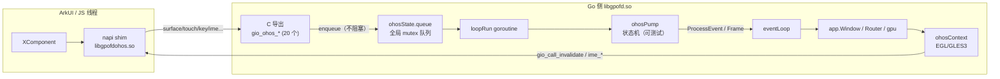

# OHOS 后端专项分析

> 本仓库相对上游的最大增量是 OpenHarmony（鸿蒙）后端：`os_ohos.go`(646) + `ohos_pump.go`(535) + `ohos_input.go`(243) + `ohos_ime.go`(92) + `ohos_glue.{c,h}`(218) + `egl_ohos.go`(76)，合计约 1,810 行（其中 Go 1,516 行）。
> 当前分支 `ohos`，另有未提交的 `ohos_pump.go` / `ohos_pump_test.go` 修改。
>
> **修复方案**：本文只做现状分析；具体修复任务、ABI v3 设计、排期与验收见 [ohos-remediation-plan.md](ohos-remediation-plan.md)。

---

## 1. 构建与文件布局

| 文件 | 构建约束 | 作用 |
|---|---|---|
| `app/os_ohos.go` | `gio_ohos || openharmony` | `window` 实现、C ABI 导出、IME 桥、picker、cursor 表 |
| `app/ohos_pump.go` | `gio_ohos || openharmony || gio_ohos_test` | 平台无关状态机（可 host 测试） |
| `app/ohos_input.go` | 同上 | 键码表、修饰键、滚轮/捏合换算 |
| `app/ohos_ime.go` | 同上 | 文本编辑辅助（删除/移动/选区/回车） |
| `app/ohos_glue.{c,h}` | cgo | 稳定 C ABI（v1 冻结 14 项 + v2 扩展） |
| `app/egl_ohos.go` | `(gio_ohos || openharmony) && !noopengl` | EGL/GLES3 context，延迟到 `Lock` 创建 surface |
| `app/datadir_ohos.go` | 同上 | 数据/缓存目录 |
| `internal/gl/names_gio_ohos.go` | `gio_ohos` | GL 函数名表 |
| `internal/egl/egl_unix.go`、`internal/gl/gl_unix.go` | 增加 `!gio_ohos` 等 | 避免与 OHOS 自带 EGL/GL 冲突 |

**构建 tag 现状**：`gio_ohos` 与 `openharmony` 等价混用；`gio_ohos_test` 仅用于在 host 上测试 pump。新增平台时需要修改 15 个既有文件的 tag（`os_wayland.go`、`os_unix.go`、`vulkan.go`、`gpu/internal/vulkan/vulkan.go` 等），这是 Open/Closed 原则的典型违反。

---

## 2. 架构



**设计要点（值得保留）**

1. **ArkUI 线程永不阻塞**：所有 C 导出只做参数拷贝 + 入队（`enqueueOhos`，[app/os_ohos.go:98-106](../app/os_ohos.go#L98-L106)）。
2. **pump 与 cgo 解耦**：`ohosSink` 接口（[app/ohos_pump.go:107-120](../app/ohos_pump.go#L107-L120)）让 pump 可在没有 OHOS SDK 的机器上跑单元测试（现有 16 个测试）。
3. **surface 延迟创建**：`Refresh` 只记录 window/size，`Lock` 时才 `CreateSurface`（[app/egl_ohos.go:47-72](../app/egl_ohos.go#L47-L72)），与 Android 一致，避免在非渲染线程碰 EGL。
4. **ABI 分层**：v1 冻结、v2 追加且容忍 NULL，头文件明确"callers must not assume ABI2"。

---

## 3. 事件与帧流程

```
ArkUI 回调
  → gio_ohos_touch/mouse/axis/key/text/focus/insets/lifecycle/pick_result...
  → enqueueOhos(ohosEvent)                 // mutex + notify(1)
  → loopRun: drainEvents()                 // 批量取出
  → ohosPump.Handle(e)                     // 26-case switch
      ├─ surface → OHOSViewEvent → deliver
      ├─ touch/mouse/axis → pointer.Event → deliver
      ├─ key → key.Event
      ├─ ime → ohosEditor*（直接改 editorState）
      └─ lifecycle/insets/picker/log
  → deliver(e) → callbacks.ProcessEvent → Window.processEvent
  → （若需要）loop.FlushEvents()
  → eventLoop 交付给客户端
```

**帧请求**：pump 在 touch/mouse/axis 后调用 `sink.ohosRequestFrame()`（工作区新增），最终走 `C.gio_call_invalidate()`；`animating` 时每个 vsync 回调 `tick()` 再要下一帧。

---

## 4. 与 Android 后端的对照

| 能力 | Android | OHOS | 重复度 |
|---|---|---|---|
| `Event/Invalidate/Run/Frame` 四件套 | `os_android.go:694-708` | `os_ohos.go:180-186` | 近逐字 |
| 事件投递 | `processEvent`(`686-692`) | `deliver`(`173-178`) | 近逐字 |
| 键码→`key.Name` | `convertKeyCode`(`943-1003`) | `ohos_input.go:82-223` | 结构同、表不同 |
| 光标 | `setCursor` | `ohosCursorNumber`(`404-430`) | 第 7 份 |
| IME | JNI + `textInputState` | 自建 `ohosEditor*` + `ohos_ime.go` | **另一套坐标系** |
| 配置 | `setConfig`(`1429-1460`) | `pump.Configure`(`526-535`)，只改本地 | 功能缺失 |
| 生命周期 | 前台服务/权限 | `gio_ohos_lifecycle`，只置 `life` | 功能缺失 |
| surface | `ANativeWindow` | `OHNativeWindow` + 显式格式/几何 | 适配层 |

**量化**：约 300–350 行（20–23%）是 Android/IME 逻辑的再表达；约 160 行是不可省的 C ABI；其余是 ArkUI 映射与 pump 状态机。

---

## 5. 功能矩阵

| 功能 | 状态 | 证据/说明 |
|---|---|---|
| 触摸（多指） | ✅ | `activeTouches` 跟踪 |
| 鼠标（按下/移动/滚轮） | ✅ | `ohos_pump.go` |
| 触控板捏合 → 缩放滚轮 | ⚠️ 工作区修复中 | 之前单指触摸会被误判为 pinch；未提交 diff 用 `touchSeen` 规避 |
| 硬件键盘 + 修饰键 | ✅ | `ohos_input.go` 键码表 + 编译期校验 |
| 软键盘 / IME（preedit、删除、移动、选区、回车） | ⚠️ | 自建桥，坐标基准与 `ime.go` 不一致（见 §6 C6） |
| 窗口装饰 | ❌ | 未实现 ArkUI 标题栏/全屏/最小化 |
| 剪贴板 | ✅ 读；写 | `gio_call_set/get_clipboard` |
| 文件选择 | ✅ | `OHOSPickFile` + `gio_ohos_pick_result` |
| 光标 | ✅ | 7 种 |
| 无障碍语义 | ❌ | 未桥接 ArkUI accessibility |
| 多窗口 | ❌ | `ohosState` 进程单例 |
| 后台/前台 | ⚠️ | `life` 仅用于抑制帧；无资源释放 |
| ABI 协商 | ❌ | 头文件有版本，Go 未查询 |
| 渲染 | ✅ EGL/GLES3 | 可选 Vulkan（build tag） |

---

## 6. 风险清单（与 [risks-and-optimizations.md](risks-and-optimizations.md#a10-fork-增量引入的耦合与债s4中) 对应）

### C3 销毁后仍投递事件 / pump 不停止（S1）

- `loopRun` 无退出条件（[app/os_ohos.go:125-136](../app/os_ohos.go#L125-L136)）；`osMain` 是 `select {}`（[app/os_ohos.go:162-166](../app/os_ohos.go#L162-L166)）。
- `DestroyEvent` 后 `w.driver = nil`，但迟到的 surface/insets/text 回调仍会 `deliver` → `Window.processEvent` → `e2.Frame = w.driver.Frame`（[app/window.go:633](../app/window.go#L633)）→ nil 解引用。
- 全局队列无界，后台时持续增长。

**修复**：`pump.Stop()` + 关闭 `wakeupCh` + 退出 `loopRun`；`deliver` 检查 `driver == nil`；队列加容量上限与"后台丢弃 move"策略。

### C4 Configure/Perform 是静默 no-op（S1/S2）

- `Configure` 只入队（[app/os_ohos.go:207-209](../app/os_ohos.go#L207-L209)）；`pump.Configure` 只改本地配置并回发 `ConfigEvent`（[app/ohos_pump.go:526-535](../app/ohos_pump.go#L526-L535)），从未调用 ArkUI 设置全屏/标题/最小化。
- `Perform` 只处理 Close（[app/os_ohos.go:239-243](../app/os_ohos.go#L239-L243)）。
- 运行时 `app.Size` 被接受进 `config.Size`，随后 `egl_ohos.Refresh` 用它设置 buffer 几何（[app/egl_ohos.go:58-59](../app/egl_ohos.go#L58-L59)），与 XComponent 实际尺寸不符时会拉伸。

**修复**：忽略 `Size`（Android 的做法）；Mode/Title 要么实现，要么在文档声明不支持；`Refresh` 始终使用 `surfaceInfo()` 的尺寸。

### C5 ABI 版本未协商（S2）

- `GIO_OHOS_ABI_VERSION=2`、`gio_ohos_host_ready()` 均未被 Go 调用；v1 shim 下 `invalidate`/vsync、insets、IME 全部空实现（`ohos_glue.c:47-57`）。
- 表现：只画第一帧后不再刷新；软键盘无光标。

**修复**：`gio_ohos_install_host` 后查询版本；<2 时记录一次警告并降级（或拒绝运行）。

### C6 IME 坐标基准不一致（S2）

- `updateIME` 发送 selection 时减去 `sn.Start`（**snippet 相对**，[app/os_ohos.go:339-348](../app/os_ohos.go#L339-L348)）。
- `ohosEditorSelect` 收到的平台索引却当作**绝对范围**直接赋值（[app/os_ohos.go:302-304](../app/os_ohos.go#L302-L304)）。
- preedit 的偏移又是相对 preedit 文本（[app/os_ohos.go:275-283](../app/os_ohos.go#L275-L283)）。

**修复**：所有入口统一转绝对 rune 索引（`base = imeState.Snippet.Start`），越界 clamp；在头文件中逐字段写明基准。

### C13 进程单例 + 死字段（S4）

- `ohosState` 持有队列/窗口/metric（[app/os_ohos.go:85-96](../app/os_ohos.go#L85-L96)）；`win` 写入后未读；`newWindow` 后 metric 变化不会同步到 pump 的副本。

**修复**：移除 `win`；metric 走 `ConfigEvent`；明确"单窗口"约束。

### C14 未处理事件不 flush（S2）

- `deliver` 在 `ProcessEvent` 返回 false 时直接 return（[app/os_ohos.go:173-178](../app/os_ohos.go#L173-L178)）。`ConfigEvent` 等合并事件可能一直等到下一个"被处理"事件才交付。
- Windows/macOS 都无条件 `FlushEvents`。

**修复**：总是 `FlushEvents()`（已有重入保护）。

### P1 逐事件日志（S3，高）

- 工作区未提交代码在每个 touch/axis 事件里 `fmt.Sprintf` + `Fprintf(stderr)`（[app/ohos_pump.go:370](../app/ohos_pump.go#L370)、444）。
- 120Hz 触摸 = 每秒 120 次分配 + 系统调用，且全局锁。

**修复**：删除；如确需诊断，走 `internal/debug` 开关并限流。

### P2 IME 全量重发（S3，中）

- `updateIME` 每次编辑都分配 `[]rune(text)`、整段 C 字符串（最多 4KB），并发 3 次 host 调用（[app/os_ohos.go:331-357](../app/os_ohos.go#L331-L357)）；preedit 时一次事件触发两次。
- **修复**：缓存上次 (snippet, selection)，只发差异；每批事件末尾发一次。

### P3 全局队列无界、无合并（S3，中）

- `enqueueOhos` 只 append（[app/os_ohos.go:98-106](../app/os_ohos.go#L98-L106)）；Present 阻塞时 move 事件堆积。
- **修复**：固定容量环形队列；对 `touch/mouse/axis` 的 move 做合并（保留每个指针最新坐标）。

---

## 7. 工作区未提交改动（截至分析时）

`git diff` 显示 `ohos_pump.go` +81/−11、`ohos_pump_test.go` +58/−3，内容：

1. **pinch 去抖**：新增 `activeTouches`/`touchSeen`/`pinchActive`/`lastPinch`；单指触摸后忽略 axis pinch；把连续 scale 转成相对比例。
2. **帧请求**：`touch/mouse/axis` 每个事件后都 `ohosRequestFrame()`，修复"只动一下/只缩放一次"。
3. **tick 逻辑**：`tick` 不再要求 `animating` 才出帧，静态界面也能响应单帧请求。
4. **调试日志**：上面 P1 的两条 `ohosLog`。

**建议**：提交前删除日志；pinch 逻辑补上"双指触摸"的测试（目前靠 `touchSeen` 的启发式，触控板+触摸混合设备可能误判）；`tick` 的语义变更应写入注释。

---

## 8. 改进路线（针对 OHOS）

### 阶段 0（1–2 天）

- 删逐事件日志；`deliver` 始终 flush；`Refresh` 忽略用户 Size；`timer.quit` 复位（共享修复）。
- 为 `ohos_pump` 增加"destroy 后事件"用例。

### 阶段 1（1 周）

- `pump.Stop()` + `loopRun` 退出 + 队列关闭；nil-driver 防护。
- ABI 版本查询与降级；头文件逐字段写明坐标基准。
- 队列限容 + move 合并。
- 把 C ABI 导出从 `os_ohos.go` 拆到 `ohos_abi.go`，IME 桥拆到 `ohos_ime_bridge.go`。

### 阶段 2（2–3 周）

- 统一 IME：把 `app/ime.go` 的 `textInputState` 提升为唯一编辑器变更入口，OHOS（以及 Android）接入；删除重复的 `ohosEditor*`。
- 实现 Mode/Title（通过 shim 调用 ArkUI），或明确文档声明不支持。
- 键码/光标表迁移到 `internal/keymap`/`internal/cursor`，与 Android/Windows 共用。
- build tag 收敛为单一 `ohos`，用注册文件替代 15 处修改。

### 阶段 3（可选）

- 无障碍语义桥（`AppendSemantics` → ArkUI）。
- Vulkan 后端在 OHOS 上的验证。
- 多窗口支持（需先去掉 `ohosState` 单例）。

---

## 9. 测试现状

- `app/ohos_pump_test.go`（294 行，16 个测试）覆盖：首帧/零尺寸、后台停帧、动画、destroy 只发一次、输入、剪贴板/insets、IME/picker。
- `app/ohos_ime_test.go`（81 行）覆盖删除/移动/选区/键名。
- `app/ohos_pump_test.go` 可在 host 运行：`go test ./app -tags gio_ohos_test -run TestOHOS` 通过。
- **缺口**：C ABI 层（`ohos_glue.c` 与 Go 导出）无测试；EGL 路径无测试；真机行为（旋转、分屏、手势返回、软键盘遮挡）无自动化。

**建议**：用 fake `gio_ohos_host` + 纯 Go 的 `ohosSink` 做 ABI 层契约测试；把"destroy 后迟到事件""ABI v1 降级""队列上限"做成表驱动用例。