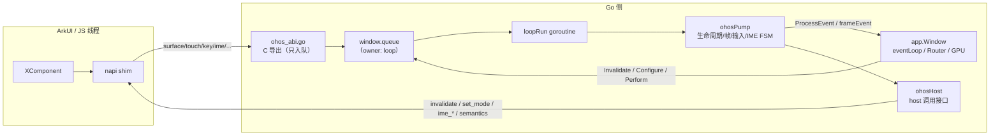
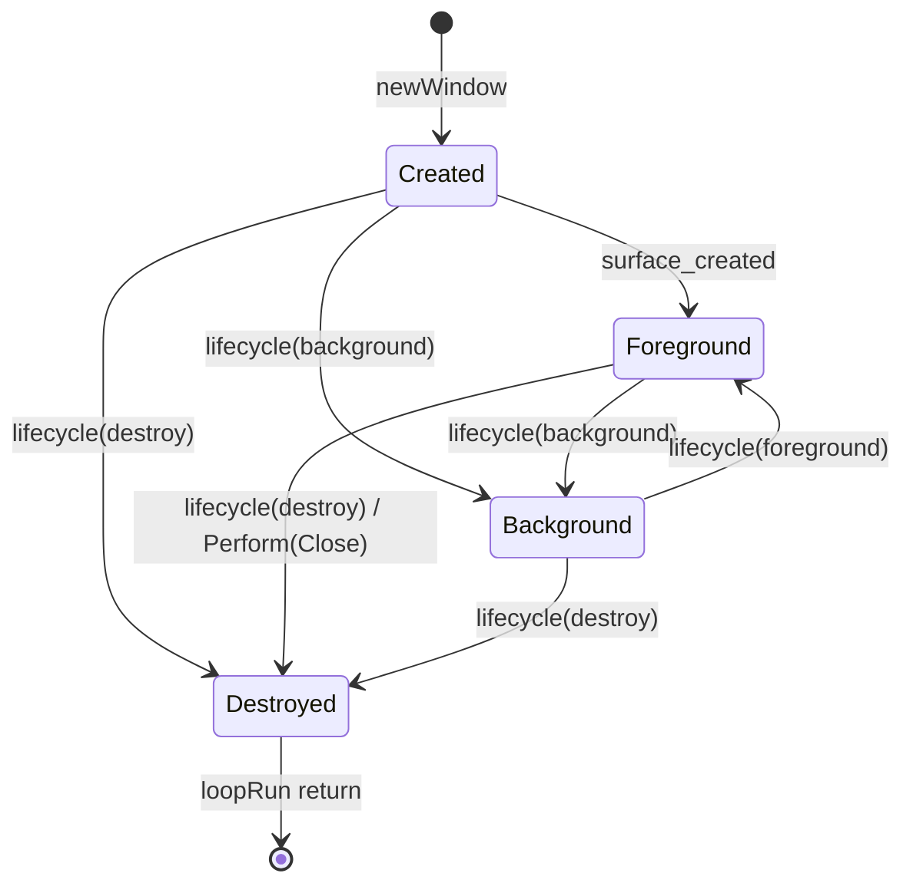
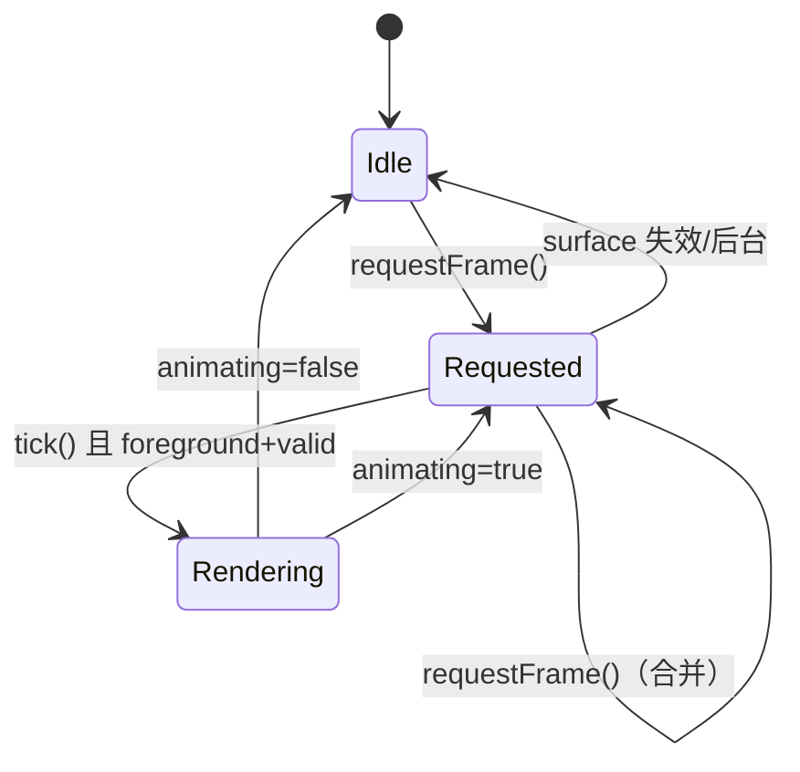
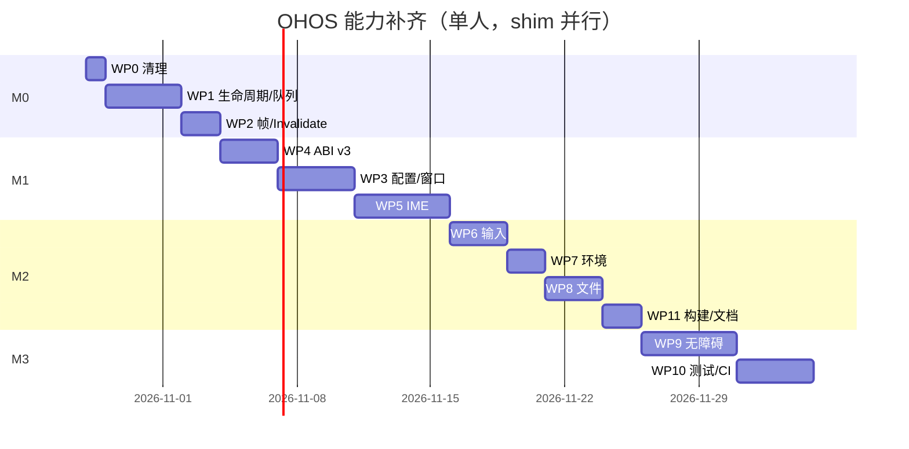

# OHOS 能力补齐修复方案

> 依据：[ohos-backend.md](ohos-backend.md) 专项分析 + 2026-10-27 对本仓库 OHOS 代码的二次复核。
> 状态：**方案文档，未修改源码**。文中行号对应当前工作区（含 `app/ohos_pump.go` 未提交改动）。
> 执行拆分（阶段/PR/日期/Gate）见 [ohos-stage-plan.md](ohos-stage-plan.md)。
> 责任边界：本文同时给出 **Go 侧**（本仓库）与 **shim 侧**（`libgpofdohos`/ArkTS，仓库外）的契约；shim 侧只定义接口与验收，不包含实现。

---

## 0. 结论摘要

### 三个必须先修的阻断项

| # | 问题 | 后果 | 证据 |
|---|---|---|---|
| B1 | `Window.Invalidate` 在 OHOS 上**不产生 FrameEvent** | 网络回调、动画调度、`Option` 后的重绘全部失效；用户只收到 `wakeupEvent` | [app/window.go:293-300](../app/window.go#L293-L300) → [app/os_ohos.go:182](../app/os_ohos.go#L182) → [app/os.go:281-291](../app/os.go#L281-L291)；`pump.Invalidate`（[ohos_pump.go:267](../app/ohos_pump.go#L267)）无人调用 |
| B2 | Destroy 后 loop 不停止、事件仍投递、`driver` 已置 nil | 迟到 surface/insets/IME 回调会解引用 nil；每次 destroy 泄漏一个 goroutine 与无界队列 | [app/os_ohos.go:125-136](../app/os_ohos.go#L125-L136)、[app/os_ohos.go:162-166](../app/os_ohos.go#L162-L166)、[app/window.go:633](../app/window.go#L633) |
| B3 | ABI 结构体尺寸无协商（v1/v2 已埋下，v3 必须修复） | 旧 shim 用更小的 host 结构体调用 `install_host`，Go 侧按新 `sizeof` 拷贝 → **越界读**；v3 若继续追加会放大问题，且 v1 缺失回调无法检测 | [app/ohos_glue.h:21-47](../app/ohos_glue.h#L21-L47)、[app/ohos_glue.c:33-41](../app/ohos_glue.c#L33-L41)、[app/os_ohos.go:434-437](../app/os_ohos.go#L434-L437) |

### 能力补齐的四个主战场

1. **窗口管理**：Mode/Title/StatusBar/NavigationBar/Orientation/TopMost/MinMax/Close 目前基本是静默 no-op（[ohos-backend.md](ohos-backend.md#c4-configureperform-是静默-no-ops1s2)）。
2. **IME**：坐标基准不统一、未复用 `textInputState`、每次编辑全量重发；中文/emoji/选区场景风险最高。
3. **输入完整性**：光标/键位表不全、Meta 缺失、混合设备捏合被永久禁用、鼠标 Move 的 Buttons 丢失。
4. **文件/无障碍/多窗口**：文件拖放缺失；语义树未桥接；多窗口受 `ohosState` 单例限制。

### 建议节奏

| 里程碑 | 范围 | 工期（单人） | 退出标准 |
|---|---|---|---|
| **M0 止血** | B1/B2/B3 + 队列/日志/生命周期 | 1.5 周 | 无 panic/竞态；Invalidate 必出帧；空闲 0 帧 |
| **M1 可用** | 窗口管理、ABI v3、IME 统一 | 3 周 | 旋转/后台/软键盘/中文输入全通过 |
| **M2 补齐** | 输入表、环境、文件/剪贴板、构建整理 | 2.5 周 | 真机清单全绿；host 测试覆盖核心 FSM |
| **M3 长尾** | 无障碍最小闭环、多窗口、权限、Vulkan | 1 季度 | 按需交付；多窗口需 ABI v4 |

### 关键决策（ADR）

| 决策 | 选择 | 理由 | 被否方案 |
|---|---|---|---|
| 事件队列归属 | 每 window 一个队列；全局只保留未附着 staging | 销毁/重建顺序清晰，天然支持未来多窗口 | 继续用全局队列（D8 无解） |
| ABI 扩展方式 | 新增 `gio_ohos_host_v3` + 带 size 的安装入口 | 不破坏 v1/v2 布局，杜绝越界读 | 直接追加字段（B3） |
| IME 实现 | 复用 `textInputState` + 独立 `ohosIME` 控制器 | 与 Wayland 共享组合/选区语义，减少分叉 | 继续维护 OHOS 专用一套 |
| `app.Size` | OHOS 忽略，Config.Size 只读 | 移动端窗口由系统控制；避免 EGL 拉伸 | 接受用户尺寸（D5） |
| 帧调度 | request-driven + animating 自续 | 空闲 0 帧，动画流畅 | 每个 vsync 都画（D2） |
| 无障碍 | 先 announce/action，虚拟树做 spike | 平台对自绘节点支持不确定 | 一开始做完整虚拟树 |
| 关闭语义 | `request_close` 交给系统，失败才本地 Destroy | 保证平台窗口与 Go 生命周期一致 | Go 直接投递 DestroyEvent |

### 不建议的做法

- **不要在 C 导出函数里直接 `pump.frame()`**：会在 ArkUI 线程上跑布局/GPU 提交，可能阻塞系统回调。
- **不要用一把全局锁包住 pump**：会把平台线程和渲染线程串行化；只锁队列。
- **不要给 `tick` 加业务判断**（如"内容没变就不画"）：变化检测属于 op/diff 层，pump 只认"请求/动画"。
- **不要修改 ABI v1/v2 结构体布局**：只能追加 v3 结构或新符号。
- **不要用 `time.AfterFunc` 频繁兜底帧**：会掩盖 shim 的 invalidate 契约问题；兜底最多一次并打点。
- **不要在 IME 路径做全文 `string` 复制**：使用 snippet + 去重，避免长文档每键 O(N)。

---

## 1. 目标、非目标与验收口径

### 1.1 目标

- **稳定**：创建→后台→前台→旋转→销毁→再创建，全程无 panic、无数据竞争、无 goroutine/内存泄漏。
- **可刷新**：任何 `Window.Invalidate`、输入事件、配置变化都能在下一 vsync 产生且仅产生必要的帧。
- **可管理**：窗口模式、标题、系统栏颜色、方向、置顶、最小/最大尺寸、关闭请求由应用控制；系统侧变化能回报。
- **可输入**：触摸/鼠标/触控板/硬件键盘/软键盘/中文 IME/emoji/选区/撤销全链路正确。
- **可集成**：文件选择、文件拖放、剪贴板、无障碍播报可用。
- **可测试**：核心状态机不依赖 cgo，可在 host 上跑；ABI 有契约测试；真机有清单。

### 1.2 非目标（本方案外或单独立项）

| 项 | 原因 | 处理 |
|---|---|---|
| 多窗口完整支持 | ABI 事件无 window id，`ohosState` 单例 | 文档化单窗口约束；ABI v4 预留 window id；M3 设计 |
| 完整虚拟无障碍树 | ArkUI 对自绘 XComponent 的虚拟节点支持有限 | 先做 announce/focus/action；虚拟树做技术验证 |
| Vulkan | OHOS 当前走 EGL/GLES3 | 保持；M3 评估 |
| 权限系统（相机/麦克风/存储） | shim 启动前申请更合适 | M3 设计 `request_permission` ABI |
| 多进程/多实例 | 平台生命周期复杂 | 不支持，文档说明 |

### 1.3 验收口径（场景化）

| 场景 | 通过标准 |
|---|---|
| 空闲界面 | 10 秒内 FrameEvent 数 = 0（无动画、无输入） |
| 点击/拖动 | 每个输入批次最多 1 帧；画面不滞后 |
| `Window.Invalidate` | 调用后 1 个 vsync 内收到 1 个 FrameEvent |
| 后台→前台 | 后台 0 帧；前台恢复 1 帧；输入状态清空 |
| 旋转 | 收到新尺寸 + 重新布局；不崩溃、不拉伸 |
| 软键盘 | 键盘弹出后 Insets 生效；收起后恢复；光标位置正确 |
| 中文输入 | 拼音 preedit、候选、上屏、删除、移动、选区均正确；无重复字符 |
| 硬件键盘 | 字母/数字/符号/快捷键/方向键/Tab 焦点正确 |
| 触控板捏合 | 双指缩放生效；触摸屏单指不误触发 |
| 关闭 | 点关闭/返回键走 DestroyEvent；资源释放；可再次创建窗口 |
| 文件 | 选择器返回路径；拖放产生 `FileDropEvent`；剪贴板读写文本 |
| ABI v1/v2/v3 | v1 降级但可用；v2 无 IME 光标；v3 全功能；无越界 |

---

## 2. 二次复核：专项文档之外的新发现

> 这些是写 `ohos-backend.md` 时未覆盖、但在制定方案时必须先解决的。

### D1. `Window.Invalidate` 不请求平台帧（P0，已代码确证）

调用链：

```
Window.Invalidate
  -> w.driver.Invalidate()          // app/window.go:298
  -> (*window).Invalidate           // app/os_ohos.go:182
  -> eventLoop.Invalidate()         // app/os.go:281
       -> 唤醒 loop / callbacks.Invalidate()
       -> callbacks.Invalidate 只 processEvent(wakeupEvent{})
```

**没有任何一步调用 `C.gio_call_invalidate()` 或 `pump.frame()`。** 而 `driver` 接口明确写着 "Invalidate requests a FrameEvent"（[app/os.go:184](../app/os.go#L184)）。当前 `pump.Invalidate`（[app/ohos_pump.go:267](../app/ohos_pump.go#L267)）已经实现了"产生一帧"，但没有任何调用者。

**影响**：`Window.Option` 之后的 `setNextFrame`、`Window.Invalidate`、`scheduleInvalidate`、`InvalidateCmd` 触发的重绘在 OHOS 上全部无效；只有输入事件会重绘。

**修复**：新增 `ohosEvInvalidate` 事件，`window.Invalidate` 入队；loop 侧调用 `pump.Invalidate()` → 请求帧。详见 WP2。

### D2. 帧调度没有"请求"状态，`tick` 可能持续空转（P0/P1）

工作区版本 `tick`（[app/ohos_pump.go:289-299](../app/ohos_pump.go#L289-L299)）在 `foreground && valid` 时**每个 vsync 都出帧**，只有 `animating` 才继续请求下一帧。如果 shim 的 vsync 回调是持续触发的（很多 ArkUI 实现如此），静态界面会 60/120fps 持续渲染。

同时 `Invalidate` 路径又不请求帧（D1），形成"该画不画、不该画一直画"的反向组合。

**修复**：引入 `frameRequested`，`tick` 只在 `frameRequested || animating` 时出帧；所有需要重绘的路径统一走 `requestFrame()`。详见 WP2。

### D3. ABI 结构体尺寸无协商（P0，潜在越界读）

`gio_ohos_install_host` 直接把 `*C.gio_ohos_host` 交给 `gio_ohos_store_host`，后者按 **Go 侧编译期的 `sizeof(gio_ohos_host)`** 做 `gio_host = *host`（[app/ohos_glue.c:33-41](../app/ohos_glue.c#L33-L41)）。**这个风险在 v1→v2 追加字段时就已经存在**：v1 shim 传更小的结构体，Go 仍按 v2 尺寸读取；v3 若继续追加只会放大问题，且无法检测。

**修复**：ABI v3 使用独立结构 `gio_ohos_host_v3` + `install_host_v3(host, size)`；C 侧按 `min(size, sizeof)` 拷贝并零填充；旧入口固定按 v2 尺寸处理。详见 §5。

### D4. 运行时 `density/fontScale` 不更新（P1）

`gio_ohos_configure` 只在启动时写 `ohosState.metric`（[app/os_ohos.go:440-469](../app/os_ohos.go#L440-L469)）；`newWindow` 把 metric 复制给 pump（[app/os_ohos.go:147-158](../app/os_ohos.go#L147-L158)）。之后系统字体缩放/显示大小变化不会反映到 `FrameEvent.Metric`，界面会错位。

**修复**：新增 `gio_ohos_density` 事件与 `pump.SetMetric`；变更后重新计算 insets 并请求帧。

### D5. 用户 `app.Size` 会污染 EGL buffer 几何（P1）

`pump.Configure` 接受任意 option，包括 `app.Size`，并把结果写进 `p.config.Size`（[app/ohos_pump.go:526-535](../app/ohos_pump.go#L526-L535)）。`egl_ohos.Refresh` 随即用这个尺寸调用 `gio_ohos_set_buffer_geometry`（[app/egl_ohos.go:47-62](../app/egl_ohos.go#L47-L62)），与 XComponent 实际尺寸不一致时画面拉伸/裁切。

**修复**：OHOS 的 `Config.Size` 只读，始终来自 surface；忽略 `Size` option（与 Android `setConfig` 一致），Min/Max 单独走 host 限制接口。

### D6. `touchSeen` 永久禁用捏合（P1/P2）

工作区用 `touchSeen` 一次性布尔值判断"这是触摸设备"（[app/ohos_pump.go:442-469](../app/ohos_pump.go#L442-L469)）。混合设备（触摸屏 + 触控板）只要出现过一次触摸，之后触控板捏合永久失效。

**修复**：优先使用 ABI 的 `source` 字段（触控板/触摸屏）分类；无 source 时用"最后一次触摸后 N 毫秒抑制窗口"替代永久布尔；ABI v2 降级路径保留启发式但可配置。

### D7. 硬件键与 text 事件可能双插入（P1）

`pump.key` 在 Press 时用 `ohosPrintable` 直接插入字符（[app/ohos_pump.go:486-502](../app/ohos_pump.go#L486-L502)），同时 shim 也可能对同一按键发送 `gio_ohos_text`。两者都调用 `EditorInsert`，会出现 "aa"。

**修复**：ABI 契约规定"硬件按键只发 key，不发 text；软键盘/输入法只发 text/preedit"；Go 侧加 50ms 去重兜底（相同 rune 且刚由硬件键插入）。

### D8. 销毁/重建的队列与顺序问题（P1）

当前队列是全局 `ohosState.queue`（[app/os_ohos.go:85-121](../app/os_ohos.go#L85-L121)），没有窗口归属：

- destroy 后 loop 不退出，继续 drain，队列继续增长；
- 重建窗口时旧窗口残留事件会投递给新窗口；
- surface 回调早于 `newWindow` 时只能依赖全局队列"碰巧"保住。

**修复**：队列归属到 window；`ohosState` 只保留"未附着窗口的 staging 队列"；destroy 清空并关闭；newWindow 原子接管 staging。详见 WP1。

### 2.1 与专项文档的追溯关系

| 专项文档结论 | 本方案 |
|---|---|
| C3 销毁后仍投递 / pump 不停止 | WP1 + D8 |
| C4 Configure/Perform 静默 no-op | WP3 |
| C5 ABI 2 假定但未协商 | WP4 + D3 |
| C6 IME 坐标基准不一致 | WP5 |
| C13 进程单例/死字段 | WP1 + M3 |
| C14 未处理事件不 flush | WP1 |
| P1 逐事件日志 | WP0 |
| P2 IME 全量重发 | WP5 |
| P3 队列无界/无合并 | WP1 |
| R1-R5 文件/死代码/文档漂移 | WP11 |
| 能力矩阵中的窗口/无障碍/拖放缺失 | WP3/WP8/WP9 |

### 2.2 能力补齐对照表

| 能力 | 现状 | 目标 | 工作包 | 需要 shim |
|---|---|---|---|---|
| 启动与渲染 | 可用；EGL 尺寸可能被 option 污染 | 稳定、空闲 0 帧 | WP0-2 | 部分 |
| Invalidate / 重绘 | **不产生帧** | 调用必出帧 | WP2 | 是（invalidate） |
| 生命周期/销毁 | loop 不退出、迟到事件 | 幂等、可重建、无泄漏 | WP1 | 是（destroy） |
| 窗口模式/标题/系统栏/方向/置顶/限制/关闭 | 基本 no-op | 全部生效并可回报 | WP3 | 是 |
| 后台/前台/旋转 | 部分 | 正确停帧/恢复/重排 | WP1/WP7 | 是 |
| 密度/字体缩放 | 仅启动时 | 运行时生效 | WP7 | 是 |
| 触摸/鼠标/滚轮 | 可用；鼠标 Buttons 丢失 | 完整事件字段 | WP6 | 部分 |
| 触控板捏合 | 永久禁用启发式 | source 分类 + 时间窗 | WP6 | 是（source） |
| 硬件键盘 | 表不全、无 Meta | 完整键位/修饰 | WP6 | 部分 |
| 软键盘/IME | 坐标不一致、全量重发 | 统一、去重、正确 | WP5 | 是 |
| 剪贴板 | 文本 | MIME + 二进制安全 | WP8 | 是 |
| 文件选择 | 基础 | 多选 + MIME | WP8 | 是 |
| 文件拖放 | 缺失 | FileDropEvent | WP8 | 是 |
| 无障碍 | 缺失 | announce + click action | WP9 | 是（能力待验证） |
| 多窗口 | 单例 | 文档化；ABI v4 预留 | M3 | 是 |
| 权限 | 缺失 | 评估/设计 | M3 | 是 |
| Vulkan | 未启用 | 评估 | M3 | 是 |

---

## 3. 设计原则

1. **单一 loop owner**：`ohosPump`、`window.queue`、编辑器状态、配置状态只在 `loopRun` goroutine 上读写；跨线程只允许"入队 + notify"。
2. **队列是唯一跨线程入口**：C 导出、`Window.Invalidate`、`SetAnimating`、`Configure` 全部走事件队列，不在平台线程直接碰窗口状态。
3. **显式状态机**：生命周期、帧调度、IME 会话各自有明确状态与转移；禁止用布尔组合表达。
4. **ABI 版本 + 尺寸 + 能力位**：新增能力必须可检测、可降级；旧 shim 不允许被越界读。
5. **降级可观测**：缺失的 host 能力只警告一次（debug 开关），不静默、不刷屏。
6. **热路径零分配/零日志**：输入/帧路径不 `Sprintf`、不 `Fprintf`、不新建 map/slice。
7. **cgo 之外可测**：队列、FSM、配置映射、IME 坐标转换放在无 cgo 文件，`gio_ohos_test` 可跑。

---

## 4. 目标架构

### 4.1 组件与线程



**关键变化**：队列从全局移到 window；pump 增加 `ohosHost` 接口（可 fake）；ABI 导出拆到独立文件；IME 拆到独立控制器。

### 4.2 生命周期状态机



规则：

- `Destroyed` 是终态：停止 drain、清空队列、投递一次 `DestroyEvent`、关闭 `done`、退出 loop。
- `Background`：不产生帧、不投递输入（触摸/键盘/滚轮），保留 surface 句柄；IME 隐藏；恢复时请求一帧。
- surface 生命周期独立于 app 生命周期：`surface_destroyed` 只让 `valid=false` 并投递无效 `OHOSViewEvent`，不进入 `Destroyed`。
- 重复 `lifecycle(destroy)` 幂等。

### 4.3 帧调度状态机



不变量：

- `requestFrame()` 只在 `foreground && valid && size>0` 时真正调用 host `invalidate`，且同一时刻最多一次未完成请求。
- `tick()` 仅在 `frameRequested || animating` 时出帧；出帧后清 `frameRequested`；`animating` 时再 `requestFrame()`。
- `surface_created/changed`、`insets`、`lifecycle(foreground)`、`Invalidate`、输入事件、影响布局的配置变化都必须 `requestFrame()`。
- `FrameEvent.Now` 使用 vsync 时间戳（新增 `gio_ohos_frame_at`），没有则 `time.Now()`。

### 4.4 队列模型

```
C 导出（任意线程）
  -> state.mu: 若 win==nil，append 到 staging；否则拿到 win
  -> win.qmu: coalesce + bounded append
  -> win.wakeupCh <- struct{}{}（非阻塞）

loopRun
  -> swap(win.queue, win.spare)  // 双缓冲，避免边处理边追加
  -> for e := range batch { pump.Handle(e) }
  -> batch 归还 spare
```

规则：

| 事件类 | 合并 | 满时丢弃 |
|---|---|---|
| `touch/mouse move` | 同 kind+id 只保留最新 | 最旧的 move |
| `axis scroll` | 不合并（保留增量） | 最旧的 scroll |
| `axis pinch` | 不合并（保留每个 scale） | 最旧的 pinch |
| `frame` | 合并为 1 个 | — |
| `insets/surface_changed/configure` | 同 kind 只保留最新 | 不丢（关键） |
| `surface_created/destroyed/lifecycle/destroy` | 不合并 | 不丢（关键） |
| `key/text/ime/pick` | 不合并 | 不丢（保序） |

容量建议：`maxQueue=256`，关键事件不占额度或单独计数；被丢弃的事件在 debug 下计数。

### 4.5 IME 数据流（复用 `textInputState`）

```
平台 preedit(text, selStartRunes, selEndRunes)
  -> ohosIME.preedit: rune->byte(preeditSelection)
  -> textInputState.pending = textInputUpdate{preeditSet:true,...}
  -> textInputState.apply(callbacks)   // 清除旧 compose、替换、设置 selection
  -> ohosIME.update(callbacks)         // 发送 ime_selection + ime_cursor + hint（去重）

平台 text(utf8)
  -> ohosIME.commit: pending.commitSet=true
  -> apply -> update

平台 ime_delete(beforeRunes, afterRunes)
  -> ohosIME.delete: 用最近一次发送的 snapshot 把 rune 偏移转 byte
  -> pending.deleteBefore/After -> apply -> update

平台 ime_set_selection(startRunes,endRunes)
  -> 绝对文档坐标；clamp 到 [Snippet.Start, Snippet.End]
  -> callbacks.SetEditorSelection；若在 compose 内，转 preedit 路径
```

### 4.6 配置/动作管线

```
Window.Option(opts) -> driver.Configure(opts) -> enqueue(ohosEvConfigure)
  -> pump.Configure: apply options（忽略 Size）-> planOHOSConfig(old,new)
  -> host.Apply(delta)（逐项、幂等、缺失则降级）
  -> 发 ConfigEvent（实际配置）-> requestFrame

Window.Perform(action) -> enqueue(ohosEvAction)
  -> pump: 映射为 host 调用（mode/raise/center/close/...）
  -> 系统回报 gio_ohos_window_mode -> 更新 config.Mode -> ConfigEvent
```

### 4.7 语义/无障碍管线（最小闭环）

```
Window.processFrame -> updateState -> （新增）SemanticsChanged hook
  -> OHOS: callbacks.AppendSemanticDiffs + LookupSemantic
  -> 序列化为 JSON（仅变化节点 + removed）
  -> host.semantics_update(json, len)

host.semantics_announce(text)  // 播报
Go 导出 gio_ohos_semantic_action(id, action)
  -> 在节点 bounds 中心合成 pointer Press/Release（click）
```

---

## 5. ABI v3 规范

### 5.1 版本与尺寸协商

| 版本 | 安装入口 | 能力 |
|---|---|---|
| v1 | `gio_ohos_install_host`（旧） | 基础窗口/输入/文本/剪贴板/日志；**无** mouse/frame/insets/IME 细节 |
| v2 | `gio_ohos_install_host`（当前） | + mouse/frame/insets/IME selection/cursor/config/pick |
| v3 | `gio_ohos_install_host_v3(host, size)` | + 窗口管理/语义/运行时密度/拖放/帧时间戳/source |

规则：

- Go 导出 `gio_ohos_abi_version() int` 返回 3；shim 在安装前查询。
- v3 安装必须带 `size`；C 侧 `memset` 后 `memcpy(min(size,sizeof))`。
- 旧入口 `gio_ohos_install_host` 固定按 v2 尺寸处理，并把缺失的 v3 回调置 NULL。
- 所有 host 调用必须判空 + 判版本，缺失时只警告一次（debug）。

### 5.2 C 头文件草案（追加，不修改 v1/v2 布局）

```c
#define GIO_OHOS_ABI_VERSION 3

/* v1/v2 结构保持不变，避免破坏旧 shim。 */
typedef struct gio_ohos_host { /* 现有字段原样保留 */ } gio_ohos_host;

typedef struct gio_ohos_host_v3 {
    gio_ohos_host v2;                 /* 必须放在首位 */

    /* 窗口管理（全部可 NULL） */
    void (*set_window_mode)(void *user, int mode);      /* 0 windowed 1 fullscreen 2 minimized 3 maximized */
    void (*set_title)(void *user, const char *title);
    void (*set_orientation)(void *user, int orientation); /* 0 any 1 landscape 2 portrait */
    void (*set_status_color)(void *user, uint32_t argb);
    void (*set_navigation_color)(void *user, uint32_t argb);
    void (*set_top_most)(void *user, int topmost);
    void (*set_window_limits)(void *user, int minw, int minh, int maxw, int maxh); /* 0 = 无限制 */
    void (*pick_file_ex)(void *user, int mode, const char *mimes, int multiple);
    void (*request_close)(void *user);
    void (*raise_window)(void *user);
    void (*center_window)(void *user);
    void (*start_window_move)(void *user);

    /* 无障碍（可 NULL） */
    void (*semantics_update)(void *user, const char *json, int length);
    void (*semantics_announce)(void *user, const char *text);

    /* 可选：让 shim 接管连续 vsync；未实现时 Go 用 invalidate 反馈循环 */
    void (*set_animating)(void *user, int animating);
} gio_ohos_host_v3;

void gio_ohos_store_host(const gio_ohos_host *host);                     /* v2，兼容 */
void gio_ohos_store_host_v3(const gio_ohos_host_v3 *host, size_t size);  /* v3 */
int  gio_ohos_host_abi_version(void);
```

新增 Go 导出（shim 调用）：

```c
int  gio_ohos_abi_version(void);                 /* 返回 3 */
void gio_ohos_install_host_v3(gio_ohos_host_v3 *host, size_t size);

/* ABI3 事件（全部可跳过） */
void gio_ohos_window_mode(int mode);
void gio_ohos_orientation(int orientation);
void gio_ohos_density(float density, float fontScale);
void gio_ohos_drop(char *uris_json);             /* ["/path/a","/path/b"]，绝对路径 */
void gio_ohos_frame_at(uint64_t vsync_ns);       /* 替代 gio_ohos_frame 的带时间版本 */
void gio_ohos_semantic_action(int nodeID, int action); /* 0 click 1 scroll_forward 2 scroll_backward */
void gio_ohos_text_source(char *utf8, int source);     /* 0 soft 1 hardware；替代 gio_ohos_text */
void gio_ohos_pinch_ex(float x, float y, float scale, int source, int mods);
```

### 5.3 兼容矩阵

| shim  Go | v1 安装 | v2 安装 | v3 安装 |
|---|---|---|---|
| v1 shim | 基础可用；无 IME 细节；Go 不发 mouse/frame | 不适用 | 不适用 |
| v2 shim | 兼容 | 全功能（当前） | 可调用 v3 安装但 v3 回调为 NULL |
| v3 shim | 兼容 | 兼容 | 全功能 |

**检测方式**：`gio_ohos_host_abi_version()` + 逐回调判空；不依赖"版本号等于某值"。

### 5.4 shim 契约（必须写入 `docs/ohos-abi.md`）

| 主题 | 约定 |
|---|---|
| 线程 | 所有 `gio_ohos_*` 可从任意线程调用；Go 侧只入队，不阻塞。 |
| 内存 | 传入的 `char*` 仅在调用期间有效；shim 必须在使用前复制。 |
| 单位 | 触摸/坐标/insets/光标均为**物理像素**；IME 偏移为**rune**；text 长度参数为**字节**。 |
| 顺序 | surface_created 必须在同尺寸的 frame 之前；destroy 之后不得再投递输入。 |
| vsync | `invalidate` 表示"请调度一次 frame"；`frame` 回调只在被调度或 animating 时触发。 |
| IME | 硬件按键不发 text；软键盘/输入法只发 text/preedit；preedit 的 sel 相对 preedit 文本。 |
| 键盘 | action 0 down / 1 up；mods 使用 `ohosMod*` 位；Meta 需新增位。 |
| 关闭 | `request_close` 后由系统走 lifecycle(destroy)；不得直接杀掉 Go 运行时。 |

---

## 6. 工作包

> 每个工作包给出：目标、改动点、关键实现、测试、验收、估时、依赖。
> 估时为**单人净工作日**，不含 shim 侧；shim 侧另列。

### WP0. 清理与安全网（1 天）

**目标**：先把工作区的调试残留与明显死代码清掉，建立可回归基线。

**改动**

- 删除 `ohos_pump.touch`/`axis` 的 `ohosLog(fmt.Sprintf(...))`（[app/ohos_pump.go:370](../app/ohos_pump.go#L370)、444），删除后检查 `fmt` 是否仍被使用。
- `ohosLog` 与 `OHOSLog` 统一：`ohosLog` 只走 `host.log`，失败回退 stderr；加 `internal/debug` 开关（如 `GIO_OHOS_DEBUG=1`），默认不输出。
- 删除 `ohosState.win` 死字段（[app/os_ohos.go:92](../app/os_ohos.go#L92)）；`ohosState.metric` 保留。
- 删除或接线 `pump.Invalidate`：本方案选择接线（WP2）。
- 删除 `ohosEvIMEKeyboard` 空 case 或实现状态记录（WP5）。
- `ohosEvSetAnimating` 复用 `e.focus` 的语义改为显式字段 `anim`（可读性）。
- 在 `docs/` 新建 `ohos-abi.md`，替换代码里对 `docs/44`/`docs/45` 的引用。

**测试**：`go test ./app -tags gio_ohos_test`；断言行/axis 不再产生日志（fake sink 的 `logs` 为空）。

**验收**：提交 diff 中无逐事件日志；`staticcheck` 对 OHOS 文件无新增告警。

---

### WP1. 生命周期、队列与投递（4 天）

**目标**：destroy 后彻底停止；事件有明确归属；无界队列与竞态消失。

**改动文件**：`app/os_ohos.go`、`app/ohos_pump.go`、`app/window.go`（共享保护）、`app/os.go`（可选）。

**1）队列归属 window**

```go
type window struct {
    callbacks *callbacks
    loop      *eventLoop
    pump      *ohosPump

    qmu     sync.Mutex
    queue   []ohosEvent
    spare   []ohosEvent
    closed  atomic.Bool
    destroyOnce sync.Once
    wakeupCh chan struct{}
    done     chan struct{}
}

type ohosState struct {
    mu      sync.Mutex
    win     *window
    staging []ohosEvent   // 仅 win==nil 时使用
    metric  unit.Metric
    dataDir, cacheDir string
}
```

```go
func enqueueOhos(e ohosEvent) {
    st := &ohosState
    st.mu.Lock()
    w := st.win
    if w == nil {
        if len(st.staging) < maxStaging {
            st.staging = append(st.staging, e)
        }
        st.mu.Unlock()
        return
    }
    st.mu.Unlock()
    w.enqueue(e)
}

func (w *window) enqueue(e ohosEvent) bool {
    if w.closed.Load() { return false }
    w.qmu.Lock()
    ok := pushOHOSEvent(&w.queue, e, maxQueue) // 见 4.4 合并/丢弃规则
    w.qmu.Unlock()
    if ok { select { case w.wakeupCh <- struct{}{}: default: } }
    return ok
}
```

- `newWindow` 在启动 loop 前：`state.mu.Lock(); state.win=w; w.queue=append(w.queue, state.staging...); state.staging=nil; state.mu.Unlock()`。
- `pump.Stop`/`destroy`：`state.mu.Lock(); if state.win==w { state.win=nil }; state.mu.Unlock(); w.closed.Store(true); 清空 queue；close(done)`。
- `loopRun` 改为：
```go
func (w *window) loopRun(options []Option) {
    w.pump.ApplyOptions(options)
    for {
        if w.drainEvents() { continue }
        select {
        case <-w.wakeupCh:
            w.loop.Wakeup()
            w.loop.FlushEvents()
        case <-w.done:
            return
        }
    }
}
```
- `drainEvents` 使用双缓冲，处理完把 batch 还给 `spare`；返回是否处理了事件，避免无事件时空转。

**2）销毁与迟到事件**

- `window.deliver`：
```go
func (w *window) deliver(e event.Event) {
    if w.closed.Load() {
        if _, ok := e.(DestroyEvent); !ok { return }
    }
    if !w.callbacks.ProcessEvent(e) {
        w.loop.FlushEvents()
        return
    }
    w.loop.FlushEvents()
}
```
- `pump.Stop`：
```go
func (p *ohosPump) Stop() {
    if p.destroyed { return }
    p.destroyed = true
    p.sink.ohosDeliver(DestroyEvent{}) // 只投递一次
}
```
- `setLifecycle(destroy)` → `p.Stop()`，幂等；`handle` 在 `destroyed` 后全部丢弃（`DestroyEvent` 由 `Stop` 直接投递一次）。
- `loopRun` 在每批事件处理后检查 `p.destroyed`，调用 `w.close()`，然后 return：
```go
func (w *window) close() {
    w.destroyOnce.Do(func() {
        w.closed.Store(true)
        w.qmu.Lock()
        w.queue, w.spare = nil, nil
        w.qmu.Unlock()
        close(w.done)
    })
}
```
这样 `DestroyEvent` 仍能正常送达，之后才彻底停止。
- `window.deliver` 在 `driver==nil` 时（共享层）对 `frameEvent` 直接 drop，防止 nil 解引用：
```go
case frameEvent:
    if w.driver == nil { return false }
```
这是**共享修复**，所有平台受益。
- `Window.Run` 在 `window.done` 关闭后不再排队：共享层给 `eventLoop` 加 `done chan struct{}`，`Run` `select { case <-done: return; case <-ran: }`；`DestroyEvent` 时 close(done)。见 WP1 第 3 小节“共享前置修复”。

**3）共享前置修复（1 天，单独提交）**

- `Window.timer.quit` 在 destroy 后置 nil（[app/window.go:670-673](../app/window.go#L670-L673)），否则重建窗口时 `scheduleInvalidate` 永久阻塞。
- `eventLoop` 增加 `done` 与可取消 `Run`（[app/os.go:294-297](../app/os.go#L294-L297)）。
- `w.driver` 读写统一锁/原子（[app/window.go:666-669](../app/window.go#L666-L669) vs 308/336/748/898）。

**测试**

- destroy 后投递 `touch/insets/surface_created`：不 panic、不产生事件、队列长度 0。
- destroy 两次：只收到 1 个 `DestroyEvent`。
- 创建→销毁→再创建：新窗口不收到旧事件；staging 中的 surface 被接管。
- 队列 10k 输入：内存有界；lifecycle/destroy 不丢。
- `go test -race`：并发 `Invalidate` + destroy 无竞态。

**验收**：`-race` 全绿；destroy 后 goroutine 数回落；迟到事件无效果。

**风险**：队列合并可能改变手势的中间 Move 采样。缓解：只合并同一指针的连续 Move，pinch/scroll 不合并；保留最近位置。

---

### WP2. 帧调度与 Invalidate（2 天）

**目标**：该画才画、调用必画、空闲零帧。

**改动**：`app/os_ohos.go`、`app/ohos_pump.go`、`app/egl_ohos.go`。

**1）新增事件与路径**

```go
const (
    ohosEvInvalidate
    ohosEvAction
    ohosEvMetric
    ohosEvWindowMode
)

func (w *window) Invalidate() {
    w.enqueue(ohosEvent{kind: ohosEvInvalidate})
}

func (p *ohosPump) Invalidate() { p.requestFrame() }
```

**2）pump 帧状态**

```go
func (p *ohosPump) requestFrame() {
    if p.destroyed || p.life != ohosForeground || !p.valid || p.config.Size == (image.Point{}) {
        return
    }
    if p.frameRequested { return }
    p.frameRequested = true
    p.sink.ohosRequestFrame()   // C.gio_call_invalidate
}

func (p *ohosPump) tick(ts time.Time) {
    if p.destroyed || p.life != ohosForeground || !p.valid { return }
    if !p.frameRequested && !p.animating { return }
    p.frameRequested = false
    p.frame(false, ts)
    if p.animating { p.requestFrame() }
}
```

- `surface()`、`setInsets`、`setLifecycle(foreground)`、`Configure`（布局相关）、`touch/mouse/axis/key`、`setFocused` 末尾改调 `p.requestFrame()`，不再直接 `p.frame()`（首帧也走 vsync）。
- `ohosEvFrame` 携带 `ts`（ABI3 `gio_ohos_frame_at`；旧入口用 `time.Now()`）。
- `frame()` 使用 `ts` 填 `FrameEvent.Now`；无 ts 时 `time.Now()`。
- `SetAnimating`：`p.animating=anim`；true → `requestFrame()`；false 不再请求（在途 tick 最多再出一帧）。
- `pump.Stop` 清 `frameRequested` 并忽略后续 tick。

**3）EGL 尺寸修正（D5）**

```go
func (p *ohosPump) Configure(options []Option) {
    old := p.config
    cnf := old
    cnf.apply(p.metric, options)
    cnf.Decorated = true
    cnf.Size = old.Size                 // 只读：surface 尺寸；Min/Max 仍作为 hint 交给 host limits
    p.config = cnf
    p.host.Apply(planOHOSConfig(old, cnf))
    p.sink.ohosDeliver(ConfigEvent{Config: cnf})
    if configAffectsLayout(old, cnf) { p.requestFrame() }
}
```

`egl_ohos.Refresh` 只使用 `pump.surfaceInfo()` 的尺寸，绝不使用用户 option。

**测试**

- 调用 `Invalidate` 3 次，只出 1 帧；下一 tick 后归零。
- 空闲 100 个 tick：0 帧。
- `SetAnimating(true)`：连续帧；`false`：停止。
- 后台：tick 0 帧；前台恢复 1 帧。
- `app.Size` option：`surfaceInfo` 尺寸不变。

**验收**：空闲 0 帧；Invalidate 1 帧；无重复帧。

**风险**：shim 若不响应 `invalidate`，会"永不重绘"。缓解：v2 兼容路径在 `Invalidate` 时直接 `p.frame()`（检测 host 是否支持 `set_animating`/v3；否则退回同步帧）。文档写明 shim 最低要求。

---

### WP3. 配置与窗口管理（4 天 Go + 3 天 shim）

**目标**：C4 的 no-op 变成真实能力，且可降级。

**1）抽象 host 调用**

```go
type ohosHost interface {
    Apply(delta ohosConfigDelta)          // 统一入口；内部逐项降级
    SetWindowMode(mode int)
    SetTitle(title string)
    SetOrientation(o int)
    SetStatusColor(argb uint32)
    SetNavigationColor(argb uint32)
    SetTopMost(bool)
    SetWindowLimits(min, max image.Point)
    RequestClose()
    RaiseWindow()
    CenterWindow()
    StartWindowMove()
    SetAnimating(bool)
    SemanticsUpdate(json []byte)
    SemanticsAnnounce(text string)
}
```

- 真实实现 `ohosHostC` 在 `os_ohos.go`，逐项判空/版本。
- 测试用 `fakeHost` 记录调用序列；pump 不再直接碰 C。

**2）纯函数 planOHOSConfig**

```go
type ohosConfigDelta struct {
    ModeSet bool; Mode int
    TitleSet bool; Title string
    OrientationSet bool; Orientation int
    StatusSet bool; Status uint32
    NavSet bool; Nav uint32
    TopMostSet bool; TopMost bool
    LimitsSet bool; Min, Max image.Point
}
func planOHOSConfig(old, new Config) ohosConfigDelta
```

映射：

| Config | host 值 |
|---|---|
| `Windowed` | 0 |
| `Fullscreen` | 1 |
| `Minimized` | 2 |
| `Maximized` | 3 |
| `AnyOrientation` | 0 |
| `LandscapeOrientation` | 1 |
| `PortraitOrientation` | 2 |
| `NRGBA` | `0xAARRGGBB`（预乘按平台要求转换） |

**3）`Perform` 映射**

```go
func (p *ohosPump) handleAction(a system.Action) {
    switch {
    case a&system.ActionClose != 0: p.host.RequestClose(); p.closeFallback()
    case a&system.ActionMinimize != 0: p.host.SetWindowMode(2)
    case a&system.ActionMaximize != 0: p.host.SetWindowMode(3)
    case a&system.ActionFullscreen != 0: p.host.SetWindowMode(1)
    case a&system.ActionUnmaximize != 0: p.host.SetWindowMode(0)
    case a&system.ActionRaise != 0: p.host.RaiseWindow()
    case a&system.ActionCenter != 0: p.host.CenterWindow()
    case a&system.ActionMove != 0: p.host.StartWindowMove()
    }
}
```

- `ActionClose`：调用 `request_close`；若 host 不支持，**同步**投递 `DestroyEvent`（当前行为）作为降级。
- 乐观更新 `config.Mode` 并立刻 `ConfigEvent`，随后由 `gio_ohos_window_mode` 校正。
- `Perform` 从"直接 deliver DestroyEvent"改为"入队 action"，保证 loop 线程。

**4）系统侧事件**

- `gio_ohos_window_mode(mode)`：更新 `config.Mode`，发 `ConfigEvent`，请求帧。
- `gio_ohos_orientation(o)`：更新 `config.Orientation`，发 `ConfigEvent`。
- `gio_ohos_density(d, fs)`：更新 `p.metric`，重算 insets，请求帧。

**5）shim 侧**

- 用 ArkUI window API 实现 set_mode/title/orientation/status/nav/topmost/limits/raise/center/move。
- 系统手势最大化/全屏/分屏时回调 `gio_ohos_window_mode`。
- 关闭：拦截返回键/关闭按钮 → `lifecycle(destroy)`，让 Go 走完整清理。

**测试**：plan 表驱动；fakeHost 调用序列；Size 不被改写；Mode 事件回写；无 host 时降级不 panic。

**验收**：真机上全屏/窗口化/标题/系统栏颜色/方向锁定/关闭全部生效；不支持项只警告一次。

---

### WP4. ABI v3 与协商（3 天 Go + 2 天 shim）

**目标**：B3 消除；新旧 shim 安全共存。

**改动**

- `ohos_glue.h`：追加 `gio_ohos_host_v3` 与安装/查询声明；保留 v1/v2。
- `ohos_glue.c`：`store_host_v3(host,size)` 零填充 + 边界拷贝；`host_abi_version()`；所有 `gio_call_*` 判空。
- `os_ohos.go`：`//export gio_ohos_install_host_v3`、`gio_ohos_abi_version`；旧 `install_host` 保持 v2 语义。
- 新增事件导出（window_mode/orientation/density/drop/frame_at/pinch_ex/text_source）。
- `docs/ohos-abi.md`：完整字段语义、单位、线程、生命周期、兼容矩阵。

**测试**

- host 侧 C 契约测试：把 `store_host` 抽到不含 NDK 的 `ohos_glue_host.c`，用 host cc 编译，测试：
  - v2 size 安装不越界（用 canary 缓冲区）；
  - v3 size 小于/等于/大于结构体；
  - NULL 回调不调用；
  - 版本查询返回值。
- Go 侧 `abiInfo` 单测：v1/v2/v3 能力矩阵。

**验收**：用 v2 shim 跑 v3 Go 不崩溃；v1 shim 降级可用；无 OOB。

**风险**：shim 未升级 → 新能力全部 NULL。缓解：v3 只作为"增强"，v2 路径保持完整；发版说明最低 shim 版本。

---

### WP5. IME 统一与坐标修正（5 天 Go + 3 天 shim）

**目标**：C6 消除；中文/emoji/选区/撤销正确；每次编辑只发一次上下文。

**1）控制器**

```go
type ohosIME struct {
    state textInputState
    sent  textInputSnapshot
    hasSent bool
    last  imeWireState   // 去重
    keyboard bool
    hint key.InputHint
}

type imeWireState struct {
    text string; start, cursor, anchor int
    hint int
    caret image.Rectangle
}
```

- `preedit(text, selStartRunes, selEndRunes)`：rune→byte 后填 `textInputUpdate{preedit, preeditSelection, preeditSet:true}`，`state.apply(w.callbacks)`。
- `commit(text)`：`textInputUpdate{commit, commitSet:true}`。
- `delete(beforeRunes, afterRunes)`：用 `sent` 转换后填 `deleteBefore/After`（新增 `convertRuneRange` 到 `textInputSnapshot`）。
- `move(direction)`：绝对位置 clamp 到 snippet，`SetEditorSelection`。
- `select(start,end)`：绝对 rune；clamp；若在 compose 内，转为 preedit 选区。
- `enter(type)`：`IME_ENTER_KEY_NEWLINE` → commit "\n"；否则发 Return Press/Release。
- `update(w)`：`prepareSurroundingText` → 若 `surroundingAwaitingSnippet` 请求更大 snippet；成功则缓存 `sent`；比较 `imeWireState` 去重；发送 `ime_selection`（长度字节、偏移 rune）+ `ime_cursor` + `ime_config`。

**2）ABI 语义固定（写入头文件）**

| 回调 | 参数单位/基准 |
|---|---|
| `ime_selection(text,length,start,end)` | text UTF-8；length 字节；start/end **相对 text 的 rune** |
| `ime_cursor(x,y,w,h)` | surface 像素 |
| `ime_config(hint)` | 0 any / 1 text / 2 numeric / ... |
| `preedit(text,selStart,selEnd)` | sel **相对 preedit 文本的 rune** |
| `ime_delete(before,after)` | 相对当前选区的 **rune** |
| `ime_move(dir)` | 1 up 2 down 3 left 4 right；当前实现只支持左右 |
| `ime_set_selection(start,end)` | **绝对文档 rune**；越界 clamp |
| `ime_enter(type)` | 8 = newline；其余发 Return |

**3）去重与降级**

- `update` 只在 `text/start/cursor/anchor/hint/caret` 变化时发送；同一帧多次调用合并。
- `EditorStateChanged` 只标记 dirty；在 `updateState` 末尾统一 flush（需要共享 hook 或在 pump 帧后调用）。
- ABI<2：跳过 `ime_selection/cursor`，仅保留 `show_keyboard` 与 text；debug 警告一次。
- `gio_ohos_text_source`：source=1（硬件）时忽略 text，避免 D7 双插入。
- 硬件键插入后 50ms 内收到相同 rune 的 text → 丢弃。

**4）测试**

- 表驱动：ASCII/中文/emoji/组合字符/选区反向/跨 snippet/组合中删除/组合中移动。
- 属性测试：任意 rune 偏移与 byte 偏移互转；任意 preedit 选区不越界。
- 回归：输入 "你好"→preedit "nihao"→上屏；光标框不跳动；无重复字符。
- Benchmark：1000 rune 文档连续输入，`update` 不分配/不 O(N)。

**验收**：中文/emoji/选区/撤销全通过；每次编辑最多 1 组 IME 调用。

---

### WP6. 输入完整性（3 天）

**目标**：键位/光标/鼠标/捏合覆盖真实设备。

**改动**

- **光标表**：补 `CursorAllScroll`、`CursorNorthWestResize`/`NE/SW/SE`、`CursorNorthSouthResize`、`CursorEastWestResize`、`CursorCell`、`CursorCopy`、`CursorAlias`、`CursorContextMenu`、`CursorHelp`、`CursorMove`、`CursorZoomIn/Out`（[app/os_ohos.go:404-430](../app/os_ohos.go#L404-L430)）。未知 → 0（默认）。
- **键位表**：numpad 运算符/小数点、ContextMenu、PrintScreen、CapsLock/NumLock/ScrollLock、媒体键（若 Gio 有 Name）、Fn 作为修饰；补 `ohosModMeta`。
- **鼠标**：跟踪 `mouseButtons`，Move 事件填 `Buttons`；Press/Release 更新；窗口失焦清空。
- **捏合**：新增 `source` 字段；无 source 时用 `lastTouch + 150ms` 抑制窗口；移除永久 `touchSeen`。
- **触摸**：`pointer.Event.Time` 使用事件时间戳；`Cancel` 清理 activeTouches；后台清理。
- **键盘重复**：依赖系统重复事件；不额外去重。
- **文本双插入**：见 WP5。

**测试**：表驱动所有键码/光标；混合设备序列（touch→axis pinch→mouse）；鼠标 Move Buttons；时间戳单调。

**验收**：真机外接键盘/鼠标/触控板全部可用；触摸屏单指不误触发 pinch。

---

### WP7. 运行环境：密度/方向/Insets（2 天 Go + 2 天 shim）

**目标**：字体缩放、旋转、分屏、软键盘遮挡正确。

**改动**

- `gio_ohos_configure` 在窗口已存在时不再只改 global：改为 `enqueueOhos(ohosEvMetric)`；pump 更新 metric + 重算 insets + 请求帧。
- `gio_ohos_orientation` 更新 `Config.Orientation`。
- `insets` 变化时：`p.frame` 使用新 insets；若尺寸变化同时发生，先 surface 后 frame。
- 旋转：`surface_changed` 更新尺寸；pump 保留旧尺寸直到新尺寸有效，避免 0 尺寸帧。
- 键盘 insets 与 `ime_keyboard` 状态联动：隐藏时 insets 归零（若系统未发）。

**测试**：metric 变化后 FrameEvent.Metric/insets 正确；旋转序列；键盘弹出/收起。

---

### WP8. 文件、剪贴板、拖放（3 天 Go + 2 天 shim）

**目标**：文件选择/拖放/剪贴板可用。

**改动**

- **文件拖放**：ABI3 `gio_ohos_drop(uris_json)` → `pump.drop` → `FileDropEvent{Paths}`；支持 `file://` 解码与去重；空 drop 也投递。
- **选择器**：`OHOSPickFile(mode)` 保留；新增 `OHOSPickFileWithOptions(mode, mimes []string, multiple bool)`；结果用 JSON，旧 newline 兼容。
- **剪贴板**：`gio_ohos_clipboard` 增加长度参数版本，避免 NUL 截断；MIME 透传；读取失败发 `transfer.DataEvent` 空内容或错误事件（按 Gio 约定）。
- **拖放源**（可选 P2）：`start_drag(mime,text)` host 回调 + `transfer` 请求；先做"能拖出文本"。

**测试**：JSON 路径解析（含空格/中文/换行）；多文件；空结果；剪贴板二进制含 NUL。

---

### WP9. 无障碍最小闭环（5 天，含 2 天技术验证）

**目标**：屏幕阅读器能读到标签、能触发点击；完整虚拟树另立项。

**改动**

- 共享 hook（增量、opt-in）：
```go
type semanticsDriver interface { SemanticsChanged() }
// Window.processFrame 末尾：
if d, ok := w.driver.(semanticsDriver); ok { d.SemanticsChanged() }
```
- OHOS 实现：
```go
func (w *window) SemanticsChanged() {
    diffs := w.callbacks.AppendSemanticDiffs(nil)
    root := w.callbacks.SemanticRoot()
    // 只序列化 diffs + root；无变化则跳过
    json := encodeSemantics(root, diffs, w.callbacks)
    w.host.SemanticsUpdate(json)
}
```
- JSON schema：
```json
{"root":1,"nodes":[{"id":2,"parent":1,"class":"button","label":"OK","desc":"","selected":false,"disabled":false,"bounds":[10,10,80,30],"actions":["click"]}],"removed":[3]}
```
- 入站 `gio_ohos_semantic_action(id, action)`：click → 取 bounds 中心，合成 `pointer.Press/Release`；scroll → `pointer.Scroll`。
- `semantics_announce(text)` 用于 toast/错误提示。

**技术验证（2 天）**：确认 ArkUI 是否允许对 XComponent 挂虚拟子节点；若不允许，则只保留 announce + 命中区域点击，完整树标记"平台受限"。

**测试**：JSON schema golden；diff/removed；action 命中；无节点时不发送。

---

### WP10. 测试体系与 CI（4 天，贯穿）

**目标**：核心逻辑可在 host 回归；真机有清单。

**改动**

- 新增 host 测试文件：
  - `ohos_queue_test.go`：合并/丢弃/容量/关键事件保序。
  - `ohos_frame_test.go`：Invalidate/animating/background。
  - `ohos_config_test.go`：plan 表驱动 + fakeHost 序列。
  - `ohos_ime_bridge_test.go`：坐标/组合/选区/去重。
  - `ohos_abi_test.go`：版本/能力矩阵（纯 Go 部分）。
- `fakeHost` + `fakeSink` 复用；所有 pump 测试不碰 cgo。
- C 契约测试：抽出 `ohos_glue_host.c`（无 NDK 头），host cc 编译 + canary 测试；CI 脚本 `go test` + `cc`。
- 基准：`BenchmarkOHOSPumpHandle`、`BenchmarkOHOSIMEUpdate`，要求稳态 0 alloc。
- CI：新增 OHOS 交叉编译 job（NDK/SDK 由 CI 提供）；`go test -tags gio_ohos_test ./app`；`go vet`；`staticcheck`。

**验收**：核心 FSM 覆盖率 > 80%；无 cgo 的 host 测试可在任意平台跑。

---

### WP11. 构建标签、文件拆分与文档（2 天）

**目标**：R1-R5 收敛；新增平台成本下降。

**改动**

- **文件拆分**：`os_ohos.go` → `os_ohos.go`（driver/window）、`ohos_abi.go`（C 导出）、`ohos_ime_bridge.go`、`ohos_config.go`、`ohos_queue.go`、`ohos_cursor.go`、`ohos_keymap.go`。
- **标签规范化**：以 `gio_ohos` 为唯一规范；`openharmony` 作为兼容别名保留一个版本，Release Notes 标注弃用；新增测试脚本检查所有 OHOS 文件标签集合一致，所有非 OHOS 平台文件都排除 `gio_ohos`。
- **文档**：`docs/ohos-abi.md`、`docs/ohos-shim.md`（生命周期/线程/单位/回调）、`docs/ohos-testing.md`（真机清单）；替换代码中的 `docs/44`/`docs/45` 引用。
- **死代码**：`ohosState.win`、`ohosKeyFn`、`ohosTextAround`（仅测试用则移到测试）、`gio_ohos_host_ready`（接线或删）、`ohosEvIMEKeyboard` 空 case。
- **注释**：中英文统一为英文注释 + 中文仅在必要处；关键不变量写 `// INVARIANT:`。

**验收**：`staticcheck` 对 OHOS 文件 0；新平台接入只需 1 个 driver 文件 + 1 个 ABI 文件 + 标签。

---

## 7. 里程碑与依赖



| 里程碑 | 包含 | 工期 | 依赖 |
|---|---|---|---|
| M0 | WP0 + WP1 + WP2 + 共享前置 | 1.5 周 | 无 |
| M1 | WP4 + WP3 + WP5 | 3 周 | M0；shim 同步 |
| M2 | WP6 + WP7 + WP8 + WP11 | 2.5 周 | M1 |
| M3 | WP9 + WP10 + 多窗口/权限/Vulkan 评估 | 1 季度 | M2 |

**shim 侧并行**：S1（ABI v3 安装）2d、S2（窗口管理）3d、S3（IME 控制器）3d、S4（生命周期/旋转/密度）2d、S5（文件/剪贴板）2d、S6（无障碍）5d。Go 侧在 shim 未就绪时用 fakeHost 测试，真机验收放在 M1/M2 末尾。

---

## 8. 测试矩阵

### 8.1 Host（无设备）

| 类型 | 覆盖 |
|---|---|
| 单测 | 队列合并/丢弃/容量、帧 FSM、配置 plan、IME 坐标、键位/光标表、语义 JSON |
| 属性测试 | rune↔byte、preedit 选区、snippet 边界、action 位组合 |
| 契约测试 | C struct 版本/尺寸/NULL 回调（host cc） |
| 基准 | pump handle、IME update、config plan（0 alloc） |
| 竞态 | `go test -race -tags gio_ohos_test ./app`（队列部分） |

### 8.2 真机清单（OHOS）

| 类别 | 场景 |
|---|---|
| 启动 | 冷启动、热启动、多实例（预期拒绝） |
| 生命周期 | 后台/前台、锁屏、分屏、旋转、销毁/重建 |
| 绘制 | 空闲 0 帧、Invalidate、动画、后台恢复、低内存 |
| 输入 | 单指/多指、鼠标、触控板、捏合、外接键盘、快捷键、Tab 焦点 |
| IME | 拼音、手写、emoji、选区、删除、移动、回车、粘贴、撤销 |
| 窗口 | 全屏/窗口化、标题、系统栏颜色、方向锁定、置顶、最小/最大、关闭 |
| 文件 | 选择器（单/多）、拖放、空结果、含空格/中文路径 |
| 剪贴板 | 文本、长文本、含 NUL、跨应用 |
| 无障碍 | 读屏播报、按钮点击、焦点顺序 |
| 稳定性 | 1 小时输入洪泛、反复旋转、反复前后台、无泄漏 |

### 8.3 CI

- `go build ./...`（桌面）。
- `GOOS=linux GOARCH=arm64 CGO_ENABLED=1` + OHOS NDK sysroot 交叉编译（按 CI 能力）。
- `go test -tags gio_ohos_test ./app`。
- `go vet` + `staticcheck`。
- C 契约测试脚本 `cc -I app app/ohos_glue_host.c test/ohos_abi_test.c`。

---

## 9. 兼容与迁移

### 9.1 shim 版本

- 最低可用：v2（当前）。v2 下缺窗口管理、语义、运行时密度、文件拖放；Go 侧降级并警告一次。
- 推荐：v3。发布说明写明"v3 新增能力，v2 仍可运行"。
- v1：只保证启动/输入/文本/剪贴板/日志；IME 无 surrounding/caret；不承诺体验。

### 9.2 构建标签

- 现在：`gio_ohos` 与 `openharmony` 等价；15 个既有文件带 `!gio_ohos && !openharmony`。
- 目标：`gio_ohos` 唯一规范；`openharmony` 保留一个版本；通过测试保证标签一致。
- 不在本方案内做"重命名所有平台构造函数"的大重构（成本高、收益低）。

### 9.3 API 兼容

- 不改变 `app` 公共 API；只新增（`OHOSPickFileWithOptions`、`SetOHOSPickHandler` 已有）。
- 行为变化：`app.Size` 在 OHOS 被忽略（文档标注）；`Perform(Close)` 改为请求平台关闭（有降级）。

---

## 10. 风险与回滚

| 风险 | 概率 | 影响 | 缓解 | 回滚 |
|---|---|---|---|---|
| shim 不响应 invalidate | 中 | 永不重绘 | v2 降级：Invalidate 直接 `p.frame()`；真机前置验证 | 保留同步帧路径 |
| shim vsync 持续触发 | 中 | 空闲耗电 | `tick` 门控 `frameRequested||animating` | 关闭 animating 反馈 |
| IME 厂商差异 | 高 | 输入错乱 | ABI 明确单位；去重；真机矩阵；保留旧实现开关 | 开关 `GIO_OHOS_IME_LEGACY=1` |
| 队列合并丢手势采样 | 低 | 拖动抖动 | 只合并同指针 Move；保留最新位置 | 关闭合并 |
| 无障碍平台受限 | 高 | 只能播报 | 先 announce/action；虚拟树单独立项 | 不阻塞发版 |
| ABI v3 shim 未更新 | 中 | 新功能不可用 | 能力检测 + 降级 | v2 路径完整 |
| 共享层改动引入回归 | 低 | 其他平台 | 独立提交 + 全量测试 | 按提交回滚 |

**功能开关建议**（编译期或环境变量）：

- `GIO_OHOS_IME_LEGACY`：回退到旧 IME 桥。
- `GIO_OHOS_NO_ACCESSIBILITY`：关闭语义上报。
- `GIO_OHOS_DEBUG`：一次性警告/日志。

---

## 11. 验收清单

### M0

- [ ] 无逐事件日志；`staticcheck` OHOS 0 告警。
- [ ] `Window.Invalidate` 1 个 vsync 内产生 1 帧。
- [ ] 空闲 10s 0 帧；动画可连续；后台 0 帧。
- [ ] destroy 后无迟到事件效果；无 goroutine/队列泄漏。
- [ ] create→destroy→create 正常。
- [ ] `-race` 通过。

### M1

- [ ] ABI v1/v2/v3 安装均不越界；v2 降级可用。
- [ ] 窗口模式/标题/系统栏/方向/置顶/关闭生效。
- [ ] 中文/emoji/选区/删除/移动/回车正确，无重复字符。
- [ ] 软键盘 insets 与光标位置正确。
- [ ] 旋转/前后台/字体缩放正确。

### M2

- [ ] 外接键盘/鼠标/触控板/触摸屏全部覆盖。
- [ ] 文件选择/拖放/剪贴板（含 NUL）可用。
- [ ] 构建标签一致；文档齐全；新增 shim 能力有契约测试。

### M3

- [ ] 读屏播报/点击可用（或明确平台限制）。
- [ ] 多窗口方案评审完成（ABI v4 草案）。
- [ ] 权限/Vulkan 评估结论。

---

## 12. 附录

### A. 关键接口草案

```go
// ohos_queue.go
type ohosQueue struct { items []ohosEvent; max int }
func (q *ohosQueue) push(e ohosEvent) bool
func (q *ohosQueue) swap(spare []ohosEvent) []ohosEvent

// ohos_frame.go
func (p *ohosPump) requestFrame()
func (p *ohosPump) tick(ts time.Time)
func (p *ohosPump) frame(sync bool, ts time.Time)

// ohos_ime_bridge.go
type ohosIME struct { ... }
func (m *ohosIME) preedit(w *callbacks, text string, selStart, selEnd int)
func (m *ohosIME) commit(w *callbacks, text string)
func (m *ohosIME) delete(w *callbacks, before, after int)
func (m *ohosIME) move(w *callbacks, dir int)
func (m *ohosIME) select(w *callbacks, start, end int)
func (m *ohosIME) enter(w *callbacks, typ int)
func (m *ohosIME) update(w *callbacks)
```

### B. 共享层最小改动清单

| 文件 | 改动 | 目的 |
|---|---|---|
| `app/window.go` | `processEvent` 对 `frameEvent` 判 `driver==nil`；destroy 后 `timer.quit=nil`；可选 `semanticsDriver` hook | 防 nil、可重建、无障碍 |
| `app/os.go` | `eventLoop.done`；`Run` 可取消；`Invalidate` 语义注释 | 防挂起 |
| `app/window.go` | `driver` 读写统一锁/原子 | 消除竞态 |
| `app/ime.go` | `textInputSnapshot.convertRuneRange`（新增，纯函数） | OHOS 删除/选区复用 |

> 这些改动对其它平台是**行为保持**的加固；建议单独 PR、单独回归。

### C. shim 侧任务清单（仓库外）

- [ ] v3 host 结构 + `install_host_v3(size)` + `abi_version`。
- [ ] `invalidate` → 调度一次 vsync；`frame_at(ns)` 回调。
- [ ] `set_window_mode/title/orientation/status/nav/topmost/limits/raise/center/move/request_close`。
- [ ] `pick_file_ex`（多选 + MIME）；文件拖放 `drop`（绝对路径 JSON）。
- [ ] IME：show/hide、selection/cursor/config、preedit/delete/move/select/enter、keyboard status；严格按 §5.4 单位。
- [ ] lifecycle：background/foreground/destroy；旋转；密度/字体缩放。
- [ ] 剪贴板：长度/二进制；MIME 透传。
- [ ] 无障碍：semantics_update/announce/action（按平台能力）。
- [ ] 测试：v1/v2/v3 兼容矩阵；异常路径（NULL 回调、0 尺寸、destroy 后调用）。

### D. 任务看板（建议）

| ID | 任务 | 估时 | 依赖 | 产出 |
|---|---|---|---:|---|---|
| WP0 | 清理/日志/死代码 | 1d | — | diff |
| WP1 | 队列/生命周期/deliver | 4d | WP0 | 代码+测试 |
| WP1s | 共享层 nil/timer/Run | 1d | — | 独立 PR |
| WP2 | 帧调度/Invalidate/Size | 2d | WP1 | 代码+测试 |
| WP4 | ABI v3 | 3d | WP0 | 头文件+C+测试 |
| WP3 | 配置/窗口管理 | 4d | WP4 | 代码+fakeHost 测试 |
| WP5 | IME 统一 | 5d | WP1 | 代码+属性测试 |
| WP6 | 输入表/鼠标/捏合 | 3d | WP2 | 代码+表测试 |
| WP7 | 密度/方向/insets | 2d | WP2 | 代码+测试 |
| WP8 | 文件/剪贴板/拖放 | 3d | WP4 | 代码+测试 |
| WP9 | 无障碍最小闭环 | 5d | WP4 | 代码+spike 报告 |
| WP10 | 测试/CI | 4d | 贯穿 | CI+报告 |
| WP11 | 拆分/标签/文档 | 2d | 全部 | 文档+diff |

**总计**：Go 侧约 39 人日（不含 shim），shim 侧约 17 人日；单人约 8 周 + 真机验收。

