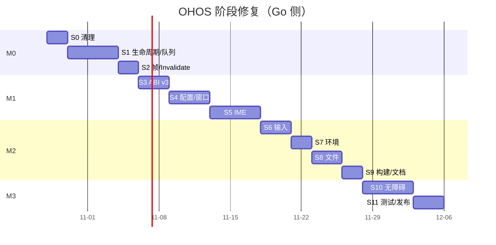

# OHOS 阶段修复计划（执行版）

> 上游方案：[ohos-remediation-plan.md](ohos-remediation-plan.md)。
> 本文把方案拆成**可合并、可验收、可回滚**的阶段与 PR，明确每个阶段的开工/收工条件、证据和停止线。
> 假设：1 名 Go 开发 + 1 名 shim 开发并行，5 天/周；开工日 2026-10-28；总工期 39 个 Go 工作日（不含真机等待）。
> 范围：Go 侧（本仓库）+ shim 侧（`libgpofdohos`，仓库外）；不改变 `app` 公共 API。

---

## 0. 使用方式

1. **一个阶段 = 一个可独立合并的增量**。阶段内可拆多个 PR，但必须能在阶段末整体回滚。
2. **阶段门（Gate）不通过，不进入下一阶段**；允许"条件通过"（Go 侧完成、shim 未就绪），但里程碑不关闭。
3. **只做本阶段范围**。禁止顺手重构、禁止跨阶段改 ABI、禁止在阶段内引入新依赖。
4. 每个阶段结束提交一份 Gate 报告（模板见 §8.3），附命令输出与真机证据。
5. 特性开关优先于分支长期共存：`GIO_OHOS_IME_LEGACY`、`GIO_OHOS_NO_A11Y`、`GIO_OHOS_SYNC_FRAME`。

---

## 1. 总览

| 阶段 | 日期 | 工作日 | 范围 | 主要交付 | 门 |
|---|---|---:|---|---|---|
| **S0** 清理与基线 | 10-28 ~ 10-29 | 2 | WP0 | 无日志/无死代码；基线数据 | G0 |
| **S1** 生命周期与队列 | 10-30 ~ 11-05 | 5 | WP1 + 共享前置 | per-window 队列、Stop/close、nil 防护 | G1 |
| **S2** 帧调度与 Invalidate | 11-06 ~ 11-09 | 2 | WP2 | request-driven 帧、Size 修正 | **M0** |
| **S3** ABI v3 | 11-10 ~ 11-12 | 3 | WP4 | v3 结构/安装/版本/契约测试 | G3a |
| **S4** 配置与窗口管理 | 11-13 ~ 11-18 | 4 | WP3 | 模式/标题/系统栏/方向/关闭 | G3b |
| **S5** IME 统一 | 11-19 ~ 11-25 | 5 | WP5 | 坐标统一、去重、中文/emoji | **M1** |
| **S6** 输入完整性 | 11-26 ~ 11-30 | 3 | WP6 | 键位/光标/鼠标/捏合 | G5 |
| **S7** 运行环境 | 12-01 ~ 12-02 | 2 | WP7 | 密度/方向/Insets | G6 |
| **S8** 文件/剪贴板/拖放 | 12-03 ~ 12-07 | 3 | WP8 | 选择器/拖放/二进制剪贴板 | G7 |
| **S9** 构建与文档 | 12-08 ~ 12-09 | 2 | WP11 + WP10 骨架 | 拆分/标签/ABI 文档/CI | **M2** |
| **S10** 无障碍最小闭环 | 12-10 ~ 12-16 | 5 | WP9 | announce/action + spike | G9 |
| **S11** 测试与发布收口 | 12-17 ~ 12-21 | 3 | WP10 | 真机矩阵/基准/发布说明 | **M3** |



**里程碑**：M0 = 11-09；M1 = 11-25；M2 = 12-09；M3 = 12-21。含 20% 缓冲的对外承诺：**2027-01-08**。

---

## 2. 阶段门规则

### 2.1 Gate 输入/输出

| 项 | 要求 |
|---|---|
| 输入 | 阶段内所有 PR 已合并到功能分支；CI 绿；Gate 报告草稿 |
| 输出 | Gate 报告（通过/条件通过/不通过）+ 下一阶段开工单 |
| 证据 | 命令输出、测试列表、真机录屏/截图、性能数字、已知问题清单 |
| 决策人 | Go owner + shim owner + QA；条件通过需记录未关闭项与截止日 |

### 2.2 停止线（任一触发即停止进入下一阶段）

- `go test -race` 失败，或 destroy 后仍有事件/帧/goroutine。
- 任意场景 panic（含 GPU/EGL/ABI 回调）。
- ABI 契约测试发现越界/未定义行为。
- 输入重复字符、IME 光标错位、选区错乱。
- 空闲仍有持续帧（>1 帧/秒）。
- 窗口关闭后进程无法再次创建窗口。

### 2.3 条件通过

shim 未就绪时，Go 阶段可用 `fakeHost` 完成 G 门，但标记"条件通过"：

- 不关闭对应里程碑；
- 真机 Gate 单独立项，截止日不得晚于下一阶段末；
- 发布说明中标注能力受限。

---

## 3. 开工前准备（10-27，0.5 天）

| 项 | 动作 | 产出 |
|---|---|---|
| 分支 | 从 `ohos` 拉 `ohos/fix-m0`，后续每阶段独立分支 | 分支命名规范 |
| 基线 | 记录当前 `go test ./...`、`-tags gio_ohos_test`、`staticcheck`、空闲帧数、启动耗时 | `docs/gates/baseline.md` |
| 设备 | 至少 1 台 OHOS 手机 + 1 台平板/触控板设备；确认 SDK/NDK 版本 | 设备清单 |
| shim | 拉 `libgpofdohos` 分支，确认可构建、可安装、可回滚 | shim 基线包 |
| CI | 增加 host 测试 job；预留 OHOS 交叉编译 job | CI 草稿 |
| 观测 | 加 `GIO_OHOS_DEBUG` 开关（S0 完成）；准备 hilog 抓取脚本 | 调试手册 |

---

## 4. 阶段详情

### S0 清理与基线（10-28 ~ 10-29，2 天）

**目标**：消除调试残留与死代码，建立可比较的基线，不改变行为。

**范围**：WP0。

**改动**

- 删除 `ohos_pump.go` 中 touch/axis 的逐事件 `ohosLog(fmt.Sprintf(...))`（当前工作区第 370、444 行）。
- `ohosLog` 统一到 host `log`；失败回退 stderr；默认静默，`GIO_OHOS_DEBUG=1` 才输出；一次性警告去重。
- 删除 `ohosState.win` 死字段；`ohosEvSetAnimating` 使用显式 `anim` 字段。
- `ohosEvIMEKeyboard` 空 case 暂时保留但加 TODO（S5 实现）。
- 新建 `docs/ohos-abi.md` 骨架、`docs/ohos-testing.md` 骨架；替换代码中的 `docs/44`/`docs/45` 引用。
- 增加脚本 `script/check-ohos-tags.sh`：校验 OHOS 文件标签集合一致、非 OHOS 平台文件排除 `gio_ohos`。

**PR**：PR-00（清理，~150 行）。

**测试/证据**

- `go test ./app -tags gio_ohos_test`。
- fake sink 的 `logs` 在 touch/axis 后为空。
- `staticcheck` OHOS 文件无新增告警。
- 基线数据表（空闲帧、启动耗时、二进制大小）。

**退出标准（G0）**：无行为变化；基线可复现；标签检查脚本通过。

**回滚**：PR-00 单独可 revert，无依赖。

**风险**：删除日志后现场诊断能力下降 → 用 debug 开关 + hilog 脚本补偿。

---

### S1 生命周期、队列与投递（10-30 ~ 11-05，5 天）

**目标**：destroy 后彻底停止；事件有归属；队列有界；迟到事件无效。

**范围**：WP1 + 共享前置（1 天）。

**PR 切片**

| PR | 内容 | 预估 |
|---|---|---|
| PR-01 | 队列结构（合并/限容/双缓冲）+ 单测 | ~300 行 |
| PR-02 | 队列迁移到 window + staging + newWindow 接管 | ~250 行 |
| PR-03 | Stop/close/loopRun 退出/deliver 守卫 | ~200 行 |
| PR-04 | 共享层：`frameEvent` nil 守卫、`timer.quit=nil`、`eventLoop.done`、driver 锁 | ~100 行 |

**关键实现**

- `window` 增加 `qmu/queue/spare/closed/destroyOnce/done`；`ohosState` 只保留 `win/staging/metric/dirs`。
- `pushOHOSEvent`：同指针 Move 合并；`frame` 合并；insets/surface_changed 合并；关键事件不丢；容量 256。
- `loopRun`：drain → 若无事件则 select（wakeup/done）；处理完检查 `p.destroyed` → `w.close()` → return。
- `deliver`：closed 时只允许 `DestroyEvent`；无论 `ProcessEvent` 返回值都 `FlushEvents`。
- `pump.Stop` 幂等，只投递一次 `DestroyEvent`。
- `Window.processEvent(frameEvent)` 在 `driver==nil` 时 drop（共享）。

**测试/证据**

- 10k 事件压力：内存有界、关键事件保序。
- create→destroy→create 50 次：无残留事件、无 goroutine 增长（`runtime.NumGoroutine` 基线）。
- destroy 后注入 touch/insets/surface：无 panic、无事件。
- `go test -race -tags gio_ohos_test ./app`。
- 共享层：`go test -race ./app`（桌面 build）。

**退出标准（G1）**：上述全绿；`DestroyEvent` 恰好一次；`done` 关闭后 `Run` 不挂起。

**回滚**：PR-01/02/03 可按顺序 revert；PR-04 独立 PR 可单独 revert。

**风险**：合并 Move 影响拖动采样 → 只合并同一指针连续 Move；提供 `GIO_OHOS_NO_COALESCE=1` 关闭。

---

### S2 帧调度与 Invalidate（11-06 ~ 11-09，2 天）

**目标**：该画才画；`Invalidate` 必出帧；空闲 0 帧；用户 Size 不再污染 EGL。

**范围**：WP2。

**PR**：PR-05（~200 行）。

**关键实现**

- 新增 `ohosEvInvalidate`；`window.Invalidate` 入队；`pump.Invalidate()` → `requestFrame()`。
- `pump` 增加 `frameRequested`；`tick(ts)` 仅在 `frameRequested || animating` 出帧；`animating` 自续。
- 所有重绘源统一 `requestFrame()`：surface/insets/foreground/input/config 布局变化/focus。
- `Configure` 强制 `cnf.Size = old.Size`；EGL 只用 `surfaceInfo()`。
- `frame()` 支持 vsync 时间戳（为 ABI3 `frame_at` 预留；当前用 `time.Now()`）。

**测试/证据**

- 连续 3 次 Invalidate → 仅 1 帧。
- 空闲 100 tick → 0 帧；`SetAnimating(true)` → 连续帧；false → 停。
- 后台 tick → 0 帧；前台 → 1 帧。
- `app.Size` option 后 `surfaceInfo` 尺寸不变。
- 真机：网络回调触发 Invalidate 后画面更新。

**退出标准（M0）**：G0+G1+G2 全通过；真机空闲 10s 0 帧；Invalidate 1 帧。

**回滚**：PR-05 独立；保留 `GIO_OHOS_SYNC_FRAME=1` 回退为同步 frame。

**风险**：shim 不响应 invalidate → 开启同步回退并阻塞 M0 关闭。

---

### S3 ABI v3（11-10 ~ 11-12，3 天）

**目标**：v3 结构/安装/查询/兼容矩阵落地；旧 shim 无越界。

**范围**：WP4。

**PR 切片**

| PR | 内容 |
|---|---|
| PR-06 | `ohos_glue.h` 增加 `gio_ohos_host_v3`、`store_host_v3(size)`、版本查询；C 边界拷贝 |
| PR-07 | Go 导出 `install_host_v3`/`abi_version`；能力探测结构；旧入口按 v2 |
| PR-08 | C 契约测试（抽出 `ohos_glue_host.c`，host cc） |

**关键实现**

- `gio_ohos_host_v3 { gio_ohos_host v2; ... }`，v2 必须在首位。
- C：`memset` + `memcpy(min(size,sizeof))`；记录 `abi`；所有 `gio_call_*` 判空。
- Go：`ohosABI{Version int; HasIME, HasWindow, HasSemantics bool}`。
- 旧 `install_host` 走 v2 尺寸；v3 shim 调 `install_host_v3`。

**测试/证据**

- canary 缓冲区测试：v2 size 安装不越界；v3 size 小于/等于/大于。
- NULL 回调不调用；版本查询返回 3。
- v2 shim 二进制跑 v3 Go：启动/输入/IME 旧能力正常。

**退出标准（G3a）**：契约测试全绿；v2 兼容运行；无 OOB。

**回滚**：ABI v3 入口未使用时零影响；删除新文件即可回退。

**风险**：shim 未升级 → v3 能力全 NULL；Go 必须逐项判空并降级。

---

### S4 配置与窗口管理（11-13 ~ 11-18，4 天）

**目标**：C4 的 no-op 变为真实能力；不可用项可诊断降级。

**范围**：WP3。

**PR 切片**

| PR | 内容 |
|---|---|
| PR-09 | `ohosHost` 接口 + `ohosHostC` + `planOHOSConfig` + fakeHost |
| PR-10 | `pump.Configure`/`handleAction` + 系统事件（mode/orientation/density）+ ConfigEvent |
| PR-11 | shim 对接（窗口模式/标题/系统栏/方向/置顶/限制/关闭） |

**关键实现**

- 映射表：Windowed=0/Fullscreen=1/Minimized=2/Maximized=3；Orientation 0/1/2。
- `Perform` 入队 action；Close 走 `request_close`，不支持才本地 `DestroyEvent`。
- 乐观更新 Mode + `ConfigEvent`，由 `gio_ohos_window_mode` 校正。
- 忽略 `Size`；Min/Max 走 `set_window_limits`。

**测试/证据**

- plan 表驱动：old/new 组合只发必要调用。
- fakeHost 调用序列（幂等、无重复）。
- 真机：全屏/窗口化/标题/系统栏/方向/置顶/关闭。
- v2 shim：降级不 panic，警告一次。

**退出标准（G3b）**：真机窗口能力全通过；v2 降级通过。

**回滚**：PR-09/10 独立；PR-11 在 shim 侧可单独回滚。

**风险**：ArkUI API 版本差异 → 按能力探测，不支持的项记录并降级。

---

### S5 IME 统一（11-19 ~ 11-25，5 天）

**目标**：坐标/组合/选区/删除/移动正确；每次编辑最多一组 IME 调用。

**范围**：WP5。

**PR 切片**

| PR | 内容 |
|---|---|
| PR-12 | 共享 `textInputSnapshot.convertRuneRange` + 单测（~80 行） |
| PR-13 | `ohosIME` 控制器：preedit/commit/delete/move/select/enter/update |
| PR-14 | `text_source` 去重 + 硬件键/text 双插入防护 |
| PR-15 | shim IME 对接与单位校验 |

**关键实现**

- `textInputState.apply` 复用；`sent` 快照用于 delete 的 rune→byte。
- `ime_selection` 相对 snippet；`ime_set_selection` 绝对文档；`preedit` 选区相对 preedit。
- `update` 去重（text/start/cursor/anchor/hint/caret）；`EditorStateChanged` 只标 dirty，帧末 flush。
- ABI<2 降级：无 surrounding/caret，保留 text。

**测试/证据**

- 表驱动：ASCII/中文/emoji/组合字符/反向选区/跨 snippet/组合中删除与移动。
- 属性测试：rune↔byte 双向、preedit 选区不越界。
- 真机：拼音上屏、候选、删除、移动、选区、撤销；无重复字符。
- Benchmark：1000 rune 连续输入 0 alloc/不 O(N)。

**退出标准（M1）**：G3a/G3b + IME 全通过；真机中文/emoji 无错位。

**回滚**：`GIO_OHOS_IME_LEGACY=1` 回退旧桥；PR-12 独立。

**风险**：厂商 IME 差异 → 保留 legacy 开关；真机矩阵覆盖至少 2 家输入法。

---

### S6 输入完整性（11-26 ~ 11-30，3 天）

**目标**：键位/光标/鼠标/捏合覆盖真实设备。

**范围**：WP6。

**PR**：PR-16（~250 行）。

**内容**

- 光标全表（AllScroll/NW/NE/SW/SE/Cell/Copy/Alias/ContextMenu/Help/Move/Zoom）。
- 键位补 numpad 运算符/ContextMenu/PrintScreen/Lock 键/Fn；Meta 修饰。
- 鼠标 `mouseButtons` 跟踪，Move 填 `Buttons`；失焦清空。
- 捏合 `source` + 150ms 抑制窗；移除永久 `touchSeen`。
- 触摸 `Time`、后台清理。

**测试**：表驱动；混合设备序列；鼠标 Move Buttons；时间戳单调。

**退出标准（G5）**：外接键鼠/触控板/触摸屏全通过。

**回滚**：PR-16 独立；捏合可回退旧启发式（开关）。

---

### S7 运行环境（12-01 ~ 12-02，2 天）

**目标**：密度/字体缩放/旋转/软键盘 Insets 正确。

**范围**：WP7。

**PR**：PR-17（~150 行）+ shim 事件。

**内容**

- `ohosEvMetric`：更新 `p.metric`、重算 insets、请求帧。
- `gio_ohos_orientation`：更新 Config + ConfigEvent。
- 旋转：先 surface 后 frame，避免 0 尺寸；键盘隐藏时 insets 归零兜底。

**测试**：metric 变化、旋转序列、键盘弹出/收起。

**退出标准（G6）**：真机旋转/字体缩放/键盘遮挡通过。

---

### S8 文件、剪贴板、拖放（12-03 ~ 12-07，3 天）

**目标**：选择器/拖放/剪贴板可用且安全。

**范围**：WP8。

**PR**：PR-18（~300 行）+ shim。

**内容**

- `gio_ohos_drop(uris_json)` → `FileDropEvent`；支持 `file://` 解码、去重、空 drop。
- `pick_file_ex`（多选/MIME）；结果 JSON；旧 newline 兼容。
- 剪贴板长度参数，避免 NUL 截断；MIME 透传。
- 拖放源（可选）先不做，M3 评估。

**测试**：路径含空格/中文/换行；多文件；空结果；含 NUL 文本。

**退出标准（G7）**：真机文件/剪贴板全通过。

---

### S9 构建、文档与 CI 骨架（12-08 ~ 12-09，2 天）

**目标**：文件拆分、标签收敛、文档齐全、CI 可跑。

**范围**：WP11 + WP10 骨架。

**PR**：PR-19（拆分/标签/文档）、PR-20（CI）。

**内容**

- `os_ohos.go` 拆为 driver/abi/ime/config/queue/cursor/keymap。
- `gio_ohos` 唯一规范；`openharmony` 兼容别名；标签检查脚本进 CI。
- `docs/ohos-abi.md`/`ohos-shim.md`/`ohos-testing.md` 完成。
- CI：host 测试 + `staticcheck` + C 契约 + OHOS 交叉编译 job。

**退出标准（M2）**：G5/G6/G7 + CI 绿；文档评审通过。

---

### S10 无障碍最小闭环（12-10 ~ 12-16，5 天）

**目标**：读屏可播报、可点击；完整虚拟树做技术验证。

**范围**：WP9。

**PR**：PR-21（共享 hook）、PR-22（语义序列化）、PR-23（action）、spike 报告。

**内容**

- `semanticsDriver` hook：`Window.processFrame` 末尾调用。
- JSON schema（root/nodes/removed/bounds/actions）；只发 diff。
- `semantics_announce`；`gio_ohos_semantic_action` 合成 click/scroll。
- Spike：ArkUI 虚拟节点能力；结论写入 `docs/ohos-a11y.md`。

**测试**：JSON golden、diff/removed、action 命中、无节点不发送；真机读屏。

**退出标准（G9）**：播报/点击可用，或明确平台限制并记录。

**风险**：平台不支持虚拟树 → 只交付 announce/action，不阻塞发布。

---

### S11 测试与发布收口（12-17 ~ 12-21，3 天）

**目标**：证据齐全、可发布、可回滚。

**范围**：WP10。

**PR**：PR-24（测试/基准/发布说明）。

**内容**

- 完成真机矩阵（§8.2）；补 `BenchmarkOHOSPumpHandle`/`BenchmarkOHOSIMEUpdate`。
- 覆盖率：核心 FSM > 80%。
- 发布说明：ABI v3、最低 shim v2、已知限制（多窗口/完整 a11y/Vulkan）。
- 版本标签与回滚包。

**退出标准（M3）**：Gate 报告全绿；发布检查单完成。

---

## 5. 并行轨道

| 周 | Go 轨 | shim 轨 | 验证轨 |
|---|---|---|---|
| W1（10-28~11-03） | S0+S1 | shim 分支/构建 | 设备准备、基线 |
| W2（11-04~11-10） | S1 收尾+S2 | v3 结构预研 | M0 真机：Invalidate/空闲 |
| W3（11-11~11-17） | S3+S4 | S1 ABI v3、S2 窗口控制 | ABI 契约、窗口能力 |
| W4（11-18~11-24） | S5 IME | S3 IME | M1 中文/emoji |
| W5（11-25~12-01） | S6+S7 | S4 生命周期/密度 | 键鼠/旋转 |
| W6（12-02~12-08） | S8+S9 | S5 文件/剪贴板 | 文件/剪贴板/M2 |
| W7（12-09~12-15） | S10 | S6 a11y | 读屏/spike |
| W8（12-16~12-22） | S11 | 收尾 | M3 回归 |

**规则**：shim 延期 > 3 天时，Go 侧继续用 fakeHost 推进 S6/S7（不依赖 shim），S5/S8 的设备验收顺延；里程碑日期不变但标记"条件通过"。

---

## 6. PR 计划

| PR | 阶段 | 内容 | 依赖 | 预估 | 回滚 |
|---|---|---|---:|---:|---|
| PR-00 | S0 | 清理/日志/死字段/文档骨架 | — | 150 | 独立 |
| PR-01 | S1 | 队列结构+单测 | PR-00 | 300 | 独立 |
| PR-02 | S1 | 队列迁移/staging | PR-01 | 250 | 独立 |
| PR-03 | S1 | Stop/close/deliver | PR-02 | 200 | 独立 |
| PR-04 | S1 | 共享层加固 | — | 100 | 独立 |
| PR-05 | S2 | 帧调度/Invalidate/Size | PR-03 | 200 | 开关 |
| PR-06 | S3 | ABI v3 头/C | PR-00 | 250 | 独立 |
| PR-07 | S3 | Go ABI 安装/能力 | PR-06 | 200 | 独立 |
| PR-08 | S3 | C 契约测试 | PR-06 | 150 | 独立 |
| PR-09 | S4 | host 接口/plan | PR-07 | 350 | 独立 |
| PR-10 | S4 | Configure/Perform/事件 | PR-09 | 200 | 独立 |
| PR-11 | S4 | shim 窗口控制 | PR-06 | shim | shim 包 |
| PR-12 | S5 | 共享 rune 转换 | — | 80 | 独立 |
| PR-13 | S5 | IME 控制器 | PR-12 | 400 | 开关 |
| PR-14 | S5 | text_source/去重 | PR-13 | 120 | 开关 |
| PR-15 | S5 | shim IME | PR-07 | shim | shim 包 |
| PR-16 | S6 | 键位/光标/鼠标/捏合 | PR-05 | 250 | 独立 |
| PR-17 | S7 | 密度/方向/Insets | PR-05 | 150 | 独立 |
| PR-18 | S8 | 文件/剪贴板/拖放 | PR-07 | 300 | 独立 |
| PR-19 | S9 | 拆分/标签/文档 | 全部 | 移动 | 独立 |
| PR-20 | S9 | CI | PR-19 | 150 | 独立 |
| PR-21 | S10 | 语义 hook | PR-10 | 100 | 开关 |
| PR-22 | S10 | 语义序列化 | PR-21 | 300 | 开关 |
| PR-23 | S10 | 语义 action | PR-22 | 150 | 开关 |
| PR-24 | S11 | 测试/基准/发布 | 全部 | 300 | 独立 |

**合并策略**：每 PR 一个 review；共享层 PR-04 单独 review（影响所有平台）；ABI PR-06 需 shim owner 会签。

---

## 7. 每日/每周节奏

| 时间 | 动作 | 产出 |
|---|---|---|
| 每日 10:00 | 15 分钟站会：昨天/今天/阻塞 | 阻塞清单 |
| 每日收工 | 自测：`go test` + 目标场景 | 日志/截图 |
| 周三 | 中期检查：是否触碰停止线 | 风险更新 |
| 周五 | Gate/演示：按 §8.3 出报告 | Gate 报告 |
| 阶段末 | 回顾：数据/问题/下一阶段开工单 | 复盘记录 |

---

## 8. 测试与证据

### 8.1 每阶段最低测试

| 阶段 | 单测 | 集成 | 真机 | 基准 |
|---|---|---|---|---|
| S0 | 日志/字段 | — | — | 基线 |
| S1 | 队列/生命周期 | create-destroy | 后台/销毁 | goroutine 数 |
| S2 | 帧 FSM | Invalidate | 空闲/动画 | 帧数 |
| S3 | ABI 能力/C 契约 | v1/v2/v3 | 启动 | — |
| S4 | plan/fakeHost | 窗口控制 | 全屏/标题/关闭 | — |
| S5 | 坐标/属性 | IME 事件 | 中文/emoji | 输入延迟 |
| S6 | 表驱动 | 混合设备 | 键鼠/触控板 | — |
| S7 | metric/insets | 旋转 | 旋转/字体 | — |
| S8 | 路径/剪贴板 | 选择器/拖放 | 文件 | — |
| S9 | 标签/文档 | CI | — | — |
| S10 | JSON/action | 语义 hook | 读屏 | — |
| S11 | 覆盖率 | 全量 | 全矩阵 | 全部 |

### 8.2 真机矩阵（最小）

- 手机：触摸、软键盘、旋转、后台、返回键、中文 IME。
- 平板/触控板：鼠标、滚轮、捏合、外接键盘、分屏。
- 低端机：1 小时输入洪泛、反复旋转/前后台、内存曲线。

### 8.3 Gate 报告模板

```md
# OHOS Gate <M0/G1/...> 报告

- 日期：
- 阶段/PR：
- 环境：设备/系统/API/shim 版本
- 命令与结果：
- 真机证据：录屏/截图/日志路径
- 性能数字：
- 未关闭项/风险：
- 决策：通过 / 条件通过（截止日） / 不通过
- 签署：Go / shim / QA
```

---

## 9. 风险与缓冲

| 风险 | 触发 | 应对 | 缓冲 |
|---|---|---|---|
| shim 延期 | 超过阶段末 3 天 | Go 侧 fakeHost 推进 S6/S7；S5/S8 设备验收顺延 | 1 周 |
| 设备不可用 | 真机排队 | 先用 fakeHost + 桌面 EGL；Gate 标记条件通过 | 3 天 |
| 厂商 IME 差异 | 中文/emoji 错乱 | 保留 legacy 开关；至少 2 家输入法 | 3 天 |
| ArkUI API 差异 | 窗口能力不可用 | 能力探测 + 降级；不阻塞发布 | 2 天 |
| 合并 Move 影响手势 | 拖动抖动 | 关闭合并开关；只保留最新位置 | 1 天 |
| 共享层回归 | 其它平台测试失败 | PR-04 独立、单独回归；必要时 revert | 1 天 |

**总缓冲**：39 人日 × 20% ≈ 8 人日，已体现在对外承诺 2027-01-08。

---

## 10. 变更控制

- **分支**：`ohos/fix-s0` … `ohos/fix-s11`；每阶段合并到 `ohos/fix` 集成分支，Gate 后再合 `ohos`。
- **开关**：
  - `GIO_OHOS_IME_LEGACY=1`：S5 回退旧 IME。
  - `GIO_OHOS_NO_A11Y=1`：关闭语义上报。
  - `GIO_OHOS_SYNC_FRAME=1`：S2 回退同步帧。
  - `GIO_OHOS_DEBUG=1`：诊断日志。
- **ABI**：v3 字段只追加，不重排；发布后冻结；破坏性变更走 v4。
- **发布**：每阶段可出内部包；对外发布只在 M2/M3。

---

## 11. 交付物

| 阶段 | 交付 |
|---|---|
| S0 | 清理 diff、基线报告、标签脚本 |
| S1 | 队列/生命周期代码+测试、共享层 PR |
| S2 | 帧调度代码+测试、M0 Gate |
| S3 | ABI v3 头/C/Go、契约测试 |
| S4 | 窗口管理代码、fakeHost 测试、shim 包 |
| S5 | IME 控制器、属性测试、M1 Gate |
| S6 | 输入表/鼠标/捏合 |
| S7 | 环境适配 |
| S8 | 文件/剪贴板/拖放 |
| S9 | 拆分/文档/CI、M2 Gate |
| S10 | 无障碍最小闭环、spike 报告 |
| S11 | 真机矩阵/基准/发布说明、M3 Gate |

---

## 12. 第一周每日任务（可直接执行）

| 日期 | 任务 | 完成标志 |
|---|---|---|
| 10-28（三） | PR-00：删日志/死字段/debug 开关/文档骨架；跑基线 | 基线报告；日志为空 |
| 10-29（四） | PR-01：队列结构 + 合并/限容单测 | 单测绿；10k 事件内存有界 |
| 10-30（五） | PR-02：队列迁移 window + staging + newWindow 接管 | create/destroy 不串事件 |
| 11-02（一） | PR-03：Stop/close/loopRun/deliver 守卫 | destroy 后无事件/无 goroutine 增长 |
| 11-03（二） | PR-04：共享层 nil/timer/Run/driver 锁；G1 预演 | `-race` 绿；G1 报告草稿 |
| 11-04（三） | S1 收尾：50 次 create/destroy、延迟事件回归 | G1 证据齐全 |
| 11-05（四） | G1 评审 + S2 开工（PR-05 骨架） | G1 通过；S2 开工单 |

> 11-06 起按 §4 的 S2 继续；每周五出 Gate 报告。
